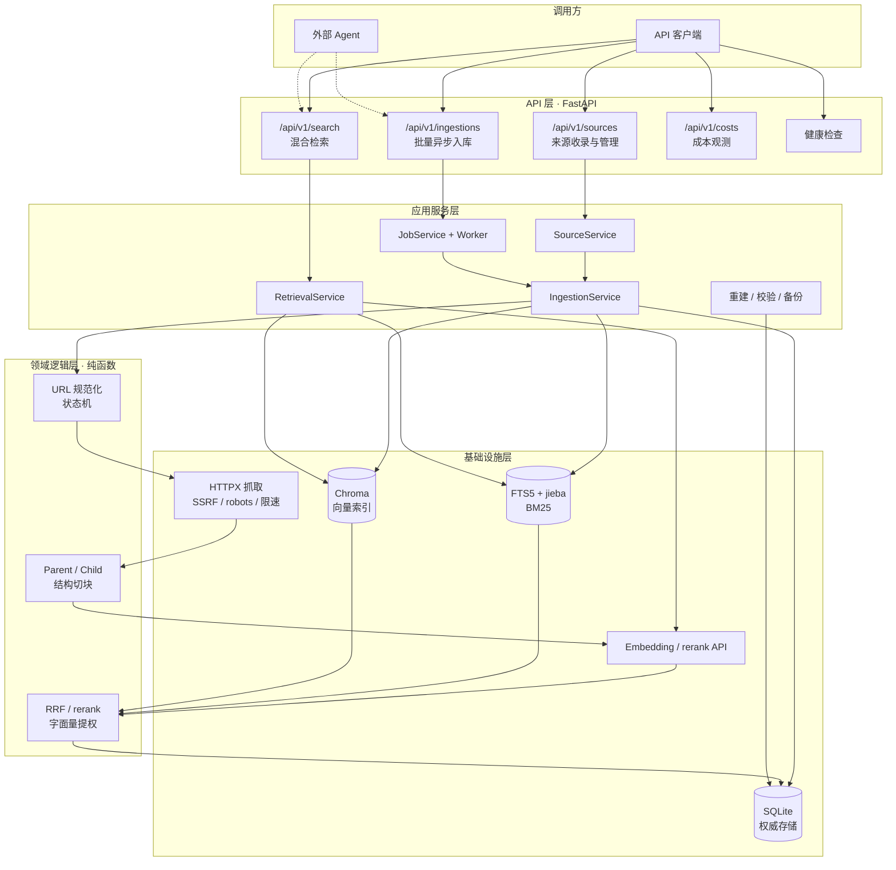

# ai-knowledge-rag — 本地可追溯的网页知识检索服务

> 将公开网页沉淀为可管理、可重建、可追溯证据的本地知识库，为外部 Agent 提供高可信的 RAG 检索底座。

---

## 项目简介

本项目面向个人 AI 学习与资料管理场景，解决公开网页“收藏后找不到、搜索靠记忆、引用无出处”的问题。提交一个公开网页 URL 后，系统会完成抓取、正文提取、结构化切块、向量与全文索引，并通过自然语言检索返回可以直接追溯原文的证据。

核心能力包括：

- **网页知识收录**：支持公开 HTTP/HTTPS 静态网页，完成 URL 规范化、最终 URL 与历史别名管理、正文提取、语言元数据、精确正文去重和结构感知切块。
- **安全与合规抓取**：内置 SSRF 地址校验、逐跳重定向复验、`robots.txt` 检查、同主机限速、超时、重试、响应体积和内容类型限制。
- **同步与异步入库**：支持单 URL 同步入库、多 URL 异步批处理、单线程 FIFO Worker、`Idempotency-Key`、逐条状态、失败重试、队列上限和重启恢复。
- **来源生命周期管理**：支持来源分页查询、详情查看、刷新、只读正文预览、级联删除和稳定错误码；内容未变化时刷新只更新检查时间。
- **Parent / Child 两级切块**：Parent 保留章节完整性，Child 作为检索与证据关联的最小单位；标题路径参与索引，命中后恢复父级上下文。
- **混合检索**：Dense 向量召回与 BM25 全文召回并行，通过 RRF 融合，再经过可选的 Cross-Encoder rerank、字面量提权和相关性门槛后返回证据。
- **精确代码与符号检索**：对引号包裹的 ASCII 片段、路径和代码符号进行字面量识别，避免语义重排压掉精确命中。
- **可追溯证据契约**：每条证据包含 `source_id`、`parent_id`、`child_id`、标题、标题路径、最终 URL、分值和原文。
- **降级与一致性**：rerank 失败可回退 RRF，Dense 或 BM25 单路失败可降级；SQLite 保存权威数据，FTS5 与 Chroma 可从 SQLite 全量或按来源重建。
- **API 成本观测**：记录 Embedding 与 rerank 的请求量、输入量、重试、失败、超时和配置单价估算，并支持滚动 24 小时预算门禁。
- **可运维与可诊断**：提供启动自检、存活与就绪检查、三处索引一致性校验、数据备份、滚动日志以及 `request_id` 全链路追踪。
- **质量与工程门禁**：覆盖单元、集成、E2E、中英文正文黄金集和检索评测，使用 Ruff、mypy、pytest 覆盖率门禁和 GitHub Actions CI。

---

## 技术栈

| 层级 | 技术 | 说明 |
|------|------|------|
| **语言与工程** | Python 3.13、uv、Ruff、mypy、pytest、GitHub Actions | 依赖锁定、静态检查、类型检查、测试与 CI |
| **Web 框架** | FastAPI、Uvicorn、Pydantic Settings | REST API、配置校验和交互式文档 |
| **权威存储** | SQLite、SQLAlchemy | 保存来源、Parent/Child、任务和成本记录 |
| **全文检索** | SQLite FTS5、jieba | 中文分词和 BM25 稀疏召回 |
| **向量检索** | Chroma PersistentClient | 本地持久化向量索引，余弦距离 |
| **网页采集** | HTTPX、Trafilatura | 安全抓取、正文提取和清洗 |
| **外部模型** | SiliconFlow `BAAI/bge-m3` | Query 与文档 Embedding |
| **重排序** | `BAAI/bge-reranker-v2-m3` | 可选 Cross-Encoder rerank，失败时回退 RRF |
| **运行模型** | 模块化单体、单机单进程、进程内 FIFO Worker | 不引入 Redis、Celery 或独立向量服务 |

---

## 系统架构



两条核心流水线：

```text
入库：URL 校验 → Job 调度 → 安全抓取 → 正文提取 → Parent/Child 切块
      → Embedding → SQLite + FTS5 + Chroma → 来源完成

检索：问题 → Dense + BM25 双路召回 → RRF 融合 → 可选 rerank
      → 字面量提权 → Parent 上下文恢复 → 相关性门槛 → 可追溯证据
```

---

## 核心功能

### 1. 安全可靠的网页知识收录

- 只接受公开 HTTP/HTTPS 静态 HTML 页面，拒绝内网地址、异常协议和不安全重定向。
- 对提交 URL 和最终 URL 进行规范化，保留提交地址、重定向地址和历史别名。
- 抓取前检查 `robots.txt`，同一主机顺序请求并限制频率。
- 使用 Trafilatura 提取正文，清理导航、广告等页面噪声，并生成确定性语言元数据。
- 以正文指纹精确去重；相同最终 URL 但正文不同会返回稳定的身份冲突错误，不覆盖已有来源。
- 对抓取超时、响应过大、内容类型不符、重定向异常等情况返回可控错误。

### 2. 同步与异步任务化入库

- `/api/v1/sources` 提供单 URL 同步入库，适合交互式调试和小规模验证。
- `/api/v1/ingestions` 提供最多 20 个 URL 的异步批处理，任务队列和单 Job 时间均有上限。
- Worker 在进程内按 FIFO 顺序处理，逐条记录 `queued / running / completed / failed / skipped` 等状态。
- 支持 `Idempotency-Key`、任务查询、短轮询、任务列表、失败项重试和进程重启后的中断恢复。
- 来源刷新复用入库流水线；内容未变化时只更新检查时间，刷新失败不破坏刷新前的可用数据。

### 3. Parent / Child 结构化切块

- 先按标题层级和章节边界生成 Parent，保留完整上下文与章节完整性。
- 再将 Parent 切分为带重叠的 Child，Child 是 Dense、BM25、rerank 和证据关联的基础单位。
- 标题路径与原文共同组成增强文本，提高专有名词、英文缩写和代码符号的召回率。
- 检索命中 Child 后恢复对应 Parent 上下文，在上下文预算内截断，减少“切块后语义不完整”的问题。
- 来源正文预览按 Parent 分页返回 Child，不暴露内部 `embedding_text`，也不提供正文修改接口。

### 4. Dense + BM25 混合检索

- Dense 检索负责语义相近和跨语言表达，BM25 负责专有名词、代码符号和精确词项。
- 两路结果通过 RRF 按物理排名融合，避免不同模型分值的量纲不一致。
- 对引号包裹的 ASCII 片段、路径和代码标记执行字面量识别，在 rerank 后将精确命中提前。
- 对查询结果设置最低相关性门槛；没有足够证据时返回空 `evidences`，不以低相关结果填充。
- 任一路召回失败时保留另一条可用路径，rerank 失败时回退 RRF 排序。

### 5. 可追溯证据返回

`/api/v1/search` 返回最终证据，而不是生成一段无法核验的答案：

| 字段 | 用途 |
|------|------|
| `source_id` | 定位知识来源 |
| `parent_id` | 恢复章节级上下文 |
| `child_id` | 定位被检索和引用的原文切片 |
| `title` | 展示页面标题 |
| `heading_path` | 展示证据在文档中的标题路径 |
| `url` | 提供最终网页地址 |
| `score` | 表示本次排序分值 |
| `text` | 返回证据原文 |

响应同时保留 Dense、BM25、RRF 候选和耗时，便于调试召回与排序问题。外部 Agent 应基于 `evidences` 生成答案，引用由 Agent 自己的回答协议负责。

### 6. API 成本与预算观测

- 记录 Embedding 和 rerank 的操作类型、供应商、模型、请求数、输入量、重试、失败、超时和币种。
- 优先使用供应商返回的 usage；缺少 usage 时使用字符数进行保守估算，并明确标记估算口径。
- 成本记录关联 `request_id`、`job_id` 和可用 `source_id`，支持按时间窗聚合查询。
- 配置输入单价后计算估算费用；配置 `API_COST_BUDGET_24H` 后，在滚动 24 小时预算超限时拒绝新的付费调用。

### 7. 索引重建与故障恢复

- SQLite 是来源与切块的唯一权威存储，FTS5 和 Chroma 都是可重建的派生索引。
- 提供全量重建和按来源重建脚本，不依赖人工修复索引数据。
- 跨 SQLite、FTS5、Chroma 的写入失败会进入可见失败状态，并对已写入部分执行幂等补偿清理。
- 一致性脚本比较三处数据的 `child_id` 集合，差异时以非零退出码报告。
- 就绪检查实际访问 SQLite、FTS5 和 Chroma，而不是只返回固定健康状态。

### 8. 质量评测与工程门禁

- 使用 148 个中英文问法覆盖专有名词、语义改写、代码查询、跨章节和无答案场景。
- 正式指标按 84 个独立问题在 Parent 层聚合，Child 指标仅用于诊断。
- 提供固定语料、冻结题目、结果文件、指标计算脚本和失败样本分析。
- 自动化门禁覆盖 Ruff、mypy、pytest、分支覆盖率 85% 和 GitHub Actions CI。
- 真实网页与外部模型检查与默认离线测试分离，避免普通测试隐式消耗费用。

---

## 项目结构

```text
ai_knowledge_RAG/
├── app/
│   ├── main.py                    # FastAPI 应用装配与生命周期
│   ├── api/
│   │   ├── sources.py             # 来源收录、查询、预览、刷新、删除
│   │   ├── ingestions.py          # 异步入库任务创建、查询与重试
│   │   ├── search.py              # 混合检索与证据返回
│   │   ├── stats.py               # 入库任务统计
│   │   ├── costs.py               # API 成本聚合
│   │   ├── health.py              # 存活与就绪检查
│   │   ├── middleware.py          # request_id、请求体大小限制
│   │   ├── errors.py              # 统一错误响应
│   │   └── schemas.py             # API 请求与响应模型
│   ├── services/
│   │   ├── source.py              # 来源生命周期与级联删除
│   │   ├── source_identity.py     # 最终 URL、别名与正文身份
│   │   ├── source_inspection.py   # Parent / Child 只读预览
│   │   ├── ingestion.py           # 抓取到双索引写入
│   │   ├── ingestion_jobs.py      # 异步任务、FIFO Worker 与恢复
│   │   ├── retrieval.py           # 双路召回、融合、rerank 与证据构造
│   │   ├── cost.py                # 用量、成本与预算门禁
│   │   ├── maintenance.py         # 重建、一致性与备份
│   │   └── evaluation.py          # 检索指标计算
│   ├── domain/
│   │   ├── url.py                 # URL 规范化
│   │   ├── state.py               # 来源状态机
│   │   ├── chunking.py            # 结构感知 Parent / Child 切块
│   │   ├── fingerprint.py         # 正文指纹
│   │   ├── language.py            # 中英文语言元数据
│   │   ├── rrf.py                 # 倒数排名融合
│   │   ├── literal.py             # 字面量与路径识别
│   │   └── ranking_metrics.py     # Recall / MRR / nDCG 等指标
│   ├── infra/
│   │   ├── db.py                  # SQLite / SQLAlchemy
│   │   ├── fts.py                 # SQLite FTS5
│   │   ├── vector.py              # Chroma 向量索引
│   │   ├── fetcher.py             # 网页抓取与重试
│   │   ├── transport.py           # SSRF 防护与固定 IP 建连
│   │   ├── robots.py              # robots.txt 检查与缓存
│   │   ├── parser.py              # 正文提取
│   │   ├── embedding.py           # Embedding API 客户端
│   │   └── rerank.py              # rerank API 客户端
│   ├── core/                      # 配置、日志、错误码、启动自检
│   └── cli/                       # 评测与维护 CLI
├── tests/
│   ├── unit/                      # 领域逻辑单元测试
│   ├── integration/               # 服务、API、SQLite 与 Chroma 集成测试
│   ├── e2e/                       # 入库至检索的完整链路
│   ├── evals/                     # 语料、题库、基线与评测结果
│   └── content_quality/           # 正文质量快照与人工标注
├── scripts/
│   ├── reindex.py                 # 重建派生索引
│   ├── check_consistency.py       # 校验三处数据一致性
│   ├── backup.py                  # 备份 SQLite 与 Chroma
│   ├── run_eval.py                # 运行检索评测
│   └── eval_grouped_metrics.py    # 聚合独立问题指标
├── docs/testing-policy.md         # 测试层级与验证门禁
├── pyproject.toml                 # 项目配置与质量门禁
├── uv.lock                        # 完整依赖锁文件
└── .env.example                   # 环境变量模板
```

---

## 快速启动

### 环境要求

- Python 3.13，项目通过 `.python-version` 锁定版本。
- [uv](https://docs.astral.sh/uv/) 用于创建环境、安装依赖和运行命令。
- 一个 SiliconFlow API Key，用于 Embedding 和可选 rerank；真实调用会产生费用。
- 主力开发环境为 Windows，CI 在 Ubuntu 上运行同一套测试。

> **Chroma 路径必须为纯 ASCII。** `CHROMA_PATH` 解析后若包含中文等非 ASCII 字符，chromadb 重启后可能无法读取 HNSW 索引。建议使用 `E:\ai_kb_data\chroma` 之类的目录；启动自检会拒绝不合规路径。

### 1. 克隆项目并安装依赖

```powershell
git clone https://github.com/Rena-xie/ai_knowledge_RAG.git
cd ai_knowledge_RAG
uv sync --frozen
```

### 2. 配置环境变量

```powershell
Copy-Item .env.example .env
```

macOS / Linux 使用 `cp .env.example .env`。至少填写：

```dotenv
EMBEDDING_API_KEY=你的 SiliconFlow Key
```

其他参数均有默认值，含义见 `.env.example`。`.env` 已被 `.gitignore` 排除。默认配置开启 rerank；未单独设置 `RERANK_API_KEY` 时复用 Embedding Key。未配置模型单价时成本显示为 `null`，系统不会伪造费用。

### 3. 启动服务

```powershell
uv run uvicorn app.main:app --host 127.0.0.1 --port 8000 --workers 1
```

**必须保持单进程。** 进程内入库锁、FIFO Worker 和 Chroma PersistentClient 都依赖单进程约束；使用多个 Worker 会导致重复入库和索引冲突。

服务启动时会校验必填配置，检查 SQLite、FTS5、数据目录和 Chroma 路径，并回收上次中断的入库任务。检查失败时服务直接退出并给出原因。

### 4. 验证部署

交互式接口文档：<http://127.0.0.1:8000/docs>

```powershell
curl.exe http://127.0.0.1:8000/health/live
curl.exe http://127.0.0.1:8000/health/ready
```

`/health/ready` 会实际访问 SQLite、校验 FTS5 并调用 Chroma `count()`；任一依赖失败时返回 `503`。

### 5. 收录网页并检索证据

```powershell
# 同步收录一个公开网页，单次操作默认预算 60 秒
curl.exe -X POST http://127.0.0.1:8000/api/v1/sources `
  -H "Content-Type: application/json" `
  -d '{"url":"https://example.com"}'

# 检索相关证据
curl.exe -X POST http://127.0.0.1:8000/api/v1/search `
  -H "Content-Type: application/json" `
  -d '{"question":"这个页面讲了什么？"}'
```

以上单引号 JSON 写法适用于 PowerShell 7 和 bash。Windows PowerShell 5.1 若出现引号被吞，可使用 `-d "{\"url\":\"https://example.com\"}"`，或直接在 `/docs` 页面调试。

### 6. 提交异步入库任务

```powershell
curl.exe -X POST http://127.0.0.1:8000/api/v1/ingestions `
  -H "Content-Type: application/json" `
  -H "Idempotency-Key: demo-20261026-001" `
  -d '{"urls":["https://example.com/a","https://example.com/b"]}'

curl.exe "http://127.0.0.1:8000/api/v1/ingestions/{job_id}?wait_seconds=10"
```

- 有实际入库项时返回 `202`；全部重复或无需处理时返回 `200`。
- 任务状态包括 `queued / running / completed / partial / failed`。
- 失败项包含稳定 `error_code`，可通过重试接口创建新任务。
- RAG 与 Learning Agent 同机运行时，建议 RAG 使用 `8001`、Agent 使用 `8000`。

### 7. 常用运维命令

```powershell
# 从 SQLite 全量重建 FTS5 与 Chroma；可加 --source-id 仅重建单个来源
uv run python scripts/reindex.py

# 校验 SQLite、FTS5、Chroma 的 child_id 集合是否一致
uv run python scripts/check_consistency.py

# 备份 SQLite 与 Chroma；建议先停止服务
uv run python scripts/backup.py --target backups

# 在独立评测库运行检索评测
uv run python scripts/run_eval.py --workdir E:/ai_kb_data/eval-kb-v3 --output tests/evals/results/latest.json
```

---

## 启动顺序总结

```text
安装依赖 → 配置 .env → 单进程启动 FastAPI → 检查 live / ready
        → 提交 URL → 完成入库 → 调用混合检索 → 返回可追溯证据
```

本项目没有 MongoDB、消息队列、独立向量服务或前端进程。启动顺序的核心约束只有一个：**所有组件必须在同一个 FastAPI 进程中运行，并且只启动一个 Worker**。

---

## 项目亮点

### 1. 混合召回而不是单向量检索

语义查询使用 Dense 召回，专有名词、代码符号和精确短语交给 BM25。RRF 只使用两路物理排名进行融合，不把不同模型的原始分值直接相加。

### 2. 专门处理代码与字面量查询

普通语义检索容易把 `//`、`==`、`->` 或路径片段当成自然语言。本项目会识别这类查询，在 rerank 后根据 BM25 名次把逐字命中的切片提前，减少精确代码片段被语义模型压掉的情况。

### 3. Parent / Child 双重上下文

Child 足够小，适合向量检索、BM25 和证据引用；Parent 足够完整，用于恢复章节上下文。系统既保留检索精度，也避免把一条孤立的句子直接交给 Agent。

### 4. 权威数据与派生索引解耦

SQLite 保存真正的来源和切块数据，FTS5 与 Chroma 可以随时重建。即使向量索引损坏、更换 Embedding 模型或重建评测库，原始知识记录仍然存在。

### 5. 失败状态可见，索引可补偿

SQLite、FTS5 和 Chroma 无法在单个事务中原子提交。本项目在跨存储写入失败时记录失败状态并清理已写部分，优先保证“失败可见”，避免留下只有向量库命中、关系库却找不到来源的脏数据。

### 6. 证据契约直接服务外部 Agent

检索接口不返回不可核验的生成答案，而是返回来源、Child、Parent、标题路径、URL 和原文。外部 Agent 可以把证据映射为自己的 `[S1]`、`[S2]` 引用，也便于用户回到原文核验。

### 7. 单机规模下的完整工程闭环

项目没有为了“看起来分布式”引入 Redis、Celery 或多个数据库服务。启动自检、单进程队列、有限重试、Job 预算、健康检查、一致性校验和备份脚本共同构成适合个人知识库的运维边界。

### 8. 检索效果有可复现证据

质量结论不只依赖感觉，而是基于冻结语料、固定问题、固定模型和可计算指标。正式 Parent 基线在 84 个独立问题上达到 Recall@5 `0.8368`、HitRate@5 `0.8734`、MRR@10 `0.8009`、nDCG@10 `0.7956`。

---

## API 端点

| 方法 | 路径 | 说明 |
|------|------|------|
| GET | `/health/live` | 进程存活检查 |
| GET | `/health/ready` | 实际检查 SQLite、FTS5 与 Chroma |
| POST | `/api/v1/sources` | 同步收录单个网页 URL |
| GET | `/api/v1/sources` | 分页查询来源 |
| GET | `/api/v1/sources/{source_id}` | 查询来源详情 |
| GET | `/api/v1/sources/{source_id}/content` | 分页预览 Parent / Child 正文 |
| DELETE | `/api/v1/sources/{source_id}` | 级联删除来源及派生数据 |
| POST | `/api/v1/sources/{source_id}/refresh` | 创建来源刷新任务 |
| POST | `/api/v1/ingestions` | 创建批量异步入库任务 |
| GET | `/api/v1/ingestions` | 分页查询入库任务 |
| GET | `/api/v1/ingestions/{job_id}` | 查询任务详情，可短轮询等待 |
| POST | `/api/v1/ingestions/{job_id}/retry` | 对失败项创建重试任务 |
| GET | `/api/v1/stats/ingestions` | 查询指定时间窗的入库统计 |
| GET | `/api/v1/costs` | 查询指定时间窗的 API 成本 |
| POST | `/api/v1/search` | 执行混合检索并返回证据 |
| GET | `/docs` | FastAPI 交互式接口文档 |

---

## 开发说明

### 检索评测

正式 Parent 基线使用清理重复来源后的独立评测副本，包含 148 个语言问法、84 个独立问题。Precision@5 因标注密度限制只作观察，不作为交付门禁：

| 口径 | Recall@5 | Precision@5 | HitRate@5 | MRR@10 | nDCG@10 | 空证据准确率 |
|------|---------:|------------:|----------:|--------:|--------:|-------------:|
| Parent 正式指标 | 0.8368 | 0.2005（观察） | 0.8734 | 0.8009 | 0.7956 | 1.0000 |
| Child 诊断指标 | 0.6379 | 0.1686 | 0.7519 | 0.6842 | 0.6226 | 1.0000 |

正式基线文件：`tests/evals/results/2026-10-26-v2-parent-clean-r2-148q.json`。详细语料、指标口径和运行方式见 [评测集说明](tests/evals/README.md)。

### 测试与静态检查

```powershell
uv run pytest -q
uv run pytest --cov --cov-report=term-missing
uv run ruff check .
uv run mypy
```

文档修改只需检查 Markdown、链接、git diff 与术语一致性，不运行代码测试。测试层级、全量测试触发条件和真实依赖检查要求见 [测试策略](docs/testing-policy.md)。

### 常见问题

| 现象 | 原因与处理 |
|------|------------|
| `uv trampoline failed to canonicalize script path` | 项目目录被移动或重命名，导致 `.venv` 启动器失效。删除 `.venv` 后重新执行 `uv sync`。 |
| 启动时报 Chroma 路径含非 ASCII | 将 `CHROMA_PATH` 指向纯 ASCII 目录后重启。 |
| 入库返回 `INGEST_BUSY` 或 `INGESTION_QUEUE_FULL` | 同步入库正在串行执行，或异步队列已满。等待当前任务完成或稍后重试。 |
| 抓取返回 `ROBOTS_DISALLOWED` | 目标站点 `robots.txt` 禁止抓取，属于预期安全行为。 |
| `/search` 返回空 `evidences` | 最高相似度低于 `MIN_DENSE_SIMILARITY`（默认 `0.58`），或库内没有相关内容。更换 Embedding 模型后需要重新校准阈值。 |
| 成本费用为 `null` | 未配置模型单价。填写 `*_INPUT_PRICE_PER_MILLION` 后才会计算配置单价估算。 |
| 成本用量标记为字符估算 | 供应商未返回 usage，字符数只用于保守估算，不等于最终 token 账单。 |

### 范围与限制

- 当前没有鉴权，只能用于单用户本机，不得直接部署到公网。
- 项目不调用 LLM，不提供问答生成；外部 Agent 的模型成本和回答质量不在本项目统计与验收范围内。
- 只支持公开静态 HTML 页面，不支持 PDF、Office、图片、音视频和 JS 动态渲染。
- 成本是按配置单价计算的估算值；迁移前调用没有历史事件，预算检查存在小幅并发竞态窗口。
- 单机部署固定单进程，不适合通过增加 Uvicorn Worker 横向扩展。

### 文档与许可

- 项目总体说明与文档优先级：[PROJECT.md](PROJECT.md)
- 历史版本规格：[v1](项目开发说明_v1.md)、[v2](项目开发说明_v2.md)
- 开发项目质量评价表：[空表](开发项目质量评价表_空表.md)、[v1](开发项目质量评价表_v1.md)、[v2](开发项目质量评价表_v2.md)
- 运维脚本说明：[scripts/README.md](scripts/README.md)
- 检索评测说明：[tests/evals/README.md](tests/evals/README.md)

本项目以 [MIT 许可证](LICENSE) 开源。
