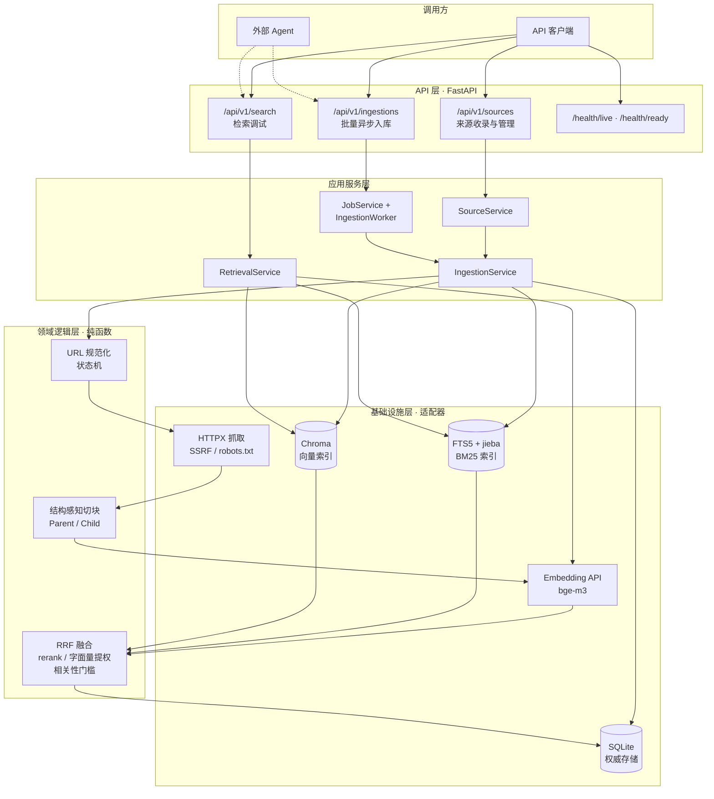

# ai-knowledge-rag

面向个人 AI 学习的网页知识采集、混合检索与可追溯证据服务。

> RAG 不调用 LLM，也不提供问答接口。它只负责入库、组织和检索证据；
> 外部 Agent 调用 `/api/v1/search` 后，使用自己的 LLM 生成中文回答和引用。

## 项目简介

学习资料散落在大量公开网页中：收藏即失联、检索靠记忆、引用无出处。

本项目把这些网页变成一座**可在本地运行、可追溯来源的知识库**：

> 提交一个公开网页 URL → 抓取并提取正文 → 结构化切块 → 建立向量与全文双索引 →
> 用自然语言检索 → 返回可追溯到原文的证据。

设计目标是"功能完整、可正常运行、数据可重建"：SQLite 是唯一权威存储，FTS5 与
Chroma 是可随时重建的派生索引；每条证据包含真实来源、Child ID、URL 和标题路径。

## 核心功能

| 能力 | 实现要点 |
| --- | --- |
| **网页知识收录** | URL 规范化与去重、SSRF 防护、`robots.txt` 合规检查、同主机限速、正文提取、结构感知切块、批量向量化、双索引写入 |
| **异步入库** | 批量 URL 任务、单线程 FIFO Worker、逐条状态、失败重试、幂等键、重启恢复 |
| **来源管理** | 分页列表、详情与状态查询、错误码回传、级联删除（关系数据 + 两处派生索引）、重复 URL 幂等处理 |
| **混合检索** | Dense + BM25 双路召回，RRF 融合 + Cross-Encoder rerank（失败回退 RRF），字面量查询按 BM25 名次提权；支持相关性门槛与单路降级 |
| **可追溯证据** | 返回来源、Child、最终 URL、标题路径、分值与原文；Agent 可据此生成自己的回答和引用 |
| **可运维** | 启动自检、健康检查实际探活 SQLite/FTS5/Chroma、索引全量/按来源重建、一致性校验、数据备份、滚动日志、`request_id` 全链路追踪 |
| **工程质量** | 单元、集成、E2E、检索评测、Ruff、mypy、覆盖率门禁和 GitHub Actions CI |

## 系统架构



两条核心流水线：

```text
入库：URL 校验 → JobService → 单线程 Worker → 抓取/正文提取 → 结构化切块
      → Embedding → FTS5 + Chroma 写入 → 逐条状态更新
检索：问题 → Dense + BM25 双路召回 → RRF 融合 → Cross-Encoder rerank
      → 字面量提权 → 父级上下文恢复 → 相关性门槛 → 证据
```

### 关键设计取舍

- **权威存储与派生索引分离**：SQLite 保存来源与切块；FTS5、Chroma 均可从关系库
  全量重建，索引损坏或更换向量库不需要人工修复数据。
- **Parent / Child 两级切块**：Parent 保留章节完整性，Child 是检索与证据关联的最小单位；
  标题路径参与索引以提升专有名词召回，命中后恢复父级上下文避免语义割裂。
- **双路召回而不是单向量检索**：BM25 补足专有名词与代码符号（`//`、`==`、`->`），
  RRF 只使用物理排名融合，避免两路分数量纲不一致。
- **rerank 与字面量分流并存**：语义查询走 rerank；引号包裹的 ASCII 片段和路径形式
  会识别为字面量查询，在 rerank 后将逐字命中的切片按 BM25 名次提前，避免语义重排
  压掉精确代码片段。
- **跨三处存储用补偿清理**：SQLite、FTS5、Chroma 无法原子提交，写入失败时回滚已写
  部分，宁可失败可见，也不留下"只有向量库有、关系库没有"的脏数据。
- **单机优先**：模块化单体、单线程异步入库 Worker、单进程运行；不引入 Redis/Celery
  等外部队列，用启动自检、队列上限和单 job 时间预算控制运行边界。

## 项目目录

```text
.
├── app/
│   ├── main.py                 # 应用装配：路由注册、中间件、生命周期
│   ├── api/                    # HTTP 层：路由与 Pydantic 模型，不含业务逻辑
│   │   ├── sources.py          # 来源收录、列表、详情、删除
│   │   ├── ingestions.py       # 异步入库任务创建、查询、重试
│   │   ├── stats.py            # 入库任务统计
│   │   ├── search.py           # 检索调试接口
│   │   ├── health.py           # 存活 / 就绪检查
│   │   ├── middleware.py       # request_id、请求体大小限制
│   │   ├── errors.py           # 统一错误响应
│   │   └── schemas.py          # 请求 / 响应数据模型
│   ├── services/               # 应用服务层：编排业务流程
│   │   ├── source.py           # 来源生命周期与级联删除
│   │   ├── ingestion.py        # 抓取 → 解析 → 切块 → 向量化 → 双索引
│   │   ├── ingestion_jobs.py   # 批量异步任务、单线程 Worker、恢复
│   │   ├── retrieval.py        # 双路召回 → RRF → rerank → 字面量提权 → 父级上下文
│   │   ├── evaluation.py       # 检索指标计算
│   │   └── maintenance.py      # 重建索引、一致性校验、备份
│   ├── domain/                 # 领域逻辑层：纯函数，无 I/O
│   │   ├── chunking.py         # 结构感知 Parent / Child 切块
│   │   ├── rrf.py              # 倒数排名融合
│   │   ├── literal.py          # 代码字面量与路径识别
│   │   ├── state.py            # 来源状态机
│   │   └── url.py              # URL 规范化与鉴重
│   ├── infra/                  # 基础设施层：外部依赖适配器
│   │   ├── db.py               # SQLite / SQLAlchemy
│   │   ├── fts.py              # FTS5 全文索引
│   │   ├── vector.py           # Chroma 向量索引
│   │   ├── fetcher.py          # 网页抓取与重试
│   │   ├── transport.py        # SSRF 防护：固定已校验 IP 建连
│   │   ├── robots.py           # robots.txt 检查与缓存
│   │   ├── parser.py           # 正文提取
│   │   ├── embedding.py        # Embedding API 客户端
│   │   └── rerank.py           # Cross-Encoder rerank 客户端
│   ├── core/                   # 配置、日志、错误码、启动自检
│   └── cli/                    # 评测与维护命令
├── tests/
│   ├── unit/                   # 领域逻辑单测
│   ├── integration/            # 服务与 API（临时 SQLite / Chroma）
│   ├── e2e/                    # 全流水线（本地夹具 + 假外部客户端）
│   └── evals/                  # 评测语料、题库与历史结果
├── scripts/                    # 索引重建、一致性校验、备份、评测
│   ├── reindex.py
│   ├── check_consistency.py
│   ├── backup.py
│   └── run_eval.py
├── .github/workflows/ci.yml    # ruff + mypy + pytest（覆盖率门槛 85%）
├── pyproject.toml
├── uv.lock                     # 依赖完全锁定
└── .env.example                # 配置项与默认值
```

## 技术栈

| 层次 | 选型 |
| --- | --- |
| 语言与工程 | Python 3.13、uv、Ruff、mypy、pytest、GitHub Actions |
| Web 框架 | FastAPI、Uvicorn、Pydantic Settings |
| 数据存储 | SQLite + SQLAlchemy（权威）、SQLite FTS5 + jieba（BM25）、Chroma（向量） |
| 采集与解析 | HTTPX、Trafilatura |
| 外部模型 | SiliconFlow `BAAI/bge-m3`（Embedding）、`BAAI/bge-reranker-v2-m3`（rerank，v2） |

## 评测结果

在 128 题（84 个独立问题）检索评测集上，当前实现的结果如下：

| 口径 | Recall@5 | HitRate@5 | Precision@5 | MRR@10 | nDCG@10 |
| --- | ---: | ---: | ---: | ---: | ---: |
| 128 题按题加权 | 0.7086 | 0.8673 | 0.2212 | 0.7106 | 0.6645 |
| 84 个独立问题 | 0.7738 | 0.8861 | 0.2152 | 0.7574 | 0.7282 |

标准 Recall@5 尚未达到 0.80 目标。历史生成链路中的引用和无答案指标不属于当前 RAG 验收。

## 部署指南

### 前置要求

- Python 3.13（由 `.python-version` 锁定；uv 缺失时会自动下载对应解释器）
- [uv](https://docs.astral.sh/uv/)
- 一个外部 API Key：SiliconFlow（Embedding/rerank）。调用会产生费用。
- 主力开发与验收环境为 Windows；CI 在 Ubuntu 上执行同一套测试。

> **Chroma 路径必须是纯 ASCII**：`CHROMA_PATH` 解析为绝对路径后若包含中文等非 ASCII
> 字符，chromadb 重启后会无法读取 HNSW 索引。启动自检会直接拒绝这类配置；可把
> `CHROMA_PATH` 指向项目外的 ASCII 目录（如 `E:\ai_kb_data\chroma`）。

### 1. 获取代码并安装依赖

```powershell
git clone https://github.com/Rena-xie/ai_knowledge_RAG.git
cd ai_knowledge_RAG
uv sync --frozen
```

### 2. 配置环境变量

```powershell
Copy-Item .env.example .env
```

macOS / Linux 使用 `cp .env.example .env`。然后编辑 `.env`，至少填写：

```dotenv
EMBEDDING_API_KEY=你的 SiliconFlow Key
```

其余参数均有默认值，含义见 `.env.example` 中的注释。`.env` 已被 `.gitignore` 排除，
不会进入版本库。

> `.env.example` 默认开启 rerank；代码安全默认关闭，未配置时不会访问 rerank API。
> 未单独配置 `RERANK_API_KEY` 时会复用 Embedding Key；关闭后检索回退到 RRF 排序。

### 3. 启动服务

```powershell
uv run uvicorn app.main:app --host 127.0.0.1 --port 8000 --workers 1
```

**必须保持单进程（`--workers 1`）**：进程内入库锁与 Chroma PersistentClient 都依赖
单进程约束，多进程会导致重复入库与索引冲突。

启动时会校验必填配置，并自动完成自检（SQLite/FTS5 可用、数据目录可写、Chroma 路径
为纯 ASCII），同时回收上次中断的入库记录。任一项失败会直接拒绝启动并给出原因。

### 4. 验证部署

打开交互式文档：<http://127.0.0.1:8000/docs>

```powershell
# 健康检查
curl.exe http://127.0.0.1:8000/health/live
curl.exe http://127.0.0.1:8000/health/ready
# ready 会实际连接 SQLite、校验 FTS5 并调用 Chroma count()；
# 任一失败返回 503 和对应检查项，异常详情只写日志。

# 收录一个公开网页（同步完成，单次预算 60 秒）
curl.exe -X POST http://127.0.0.1:8000/api/v1/sources `
  -H "Content-Type: application/json" `
  -d '{"url":"https://example.com"}'

# 检索相关证据
curl.exe -X POST http://127.0.0.1:8000/api/v1/search `
  -H "Content-Type: application/json" `
  -d '{"question":"这个页面讲了什么？"}'
```

`/api/v1/search` 返回 Dense、BM25、融合结果、证据和耗时。外部 Agent 使用这些证据
调用自己的 LLM；RAG 不生成答案。

> 示例使用单引号包裹 JSON（PowerShell 7 / bash 通用）。Windows PowerShell 5.1 若出现
> 引号被吞，改用 `-d "{\"url\":\"https://example.com\"}"` 或直接在 `/docs` 页面调试。

### 4.1 异步入库（v2）

v2 新增批量异步入库接口，适合 Agent 或脚本一次提交多个链接：

```powershell
curl.exe -X POST http://127.0.0.1:8000/api/v1/ingestions `
  -H "Content-Type: application/json" `
  -d '{"urls":["https://example.com/a","https://example.com/b"]}'

curl.exe "http://127.0.0.1:8000/api/v1/ingestions/{job_id}?wait_seconds=10"
```

- 有实际入库项返回 `202`，全部重复或无需处理返回 `200`。
- job 状态为 `queued / running / completed / partial / failed`，失败项带 `error_code`。
- 可选 `Idempotency-Key` 请求头，防止重复提交。
- 与 Learning Agent 同机运行时，建议 RAG 使用 `8001`、Agent 使用 `8000`。

刷新来源与查看统计：

```powershell
# 重新抓取并替换指定来源（内容未变化时只更新 last_checked_at）
curl.exe -X POST http://127.0.0.1:8000/api/v1/sources/12/refresh

# 近 24 小时任务统计
curl.exe "http://127.0.0.1:8000/api/v1/stats/ingestions?since_hours=24"
```

### 5. 常用运维命令

```powershell
# 从 SQLite 全量重建派生索引（也可 --source-id 3 只重建单个来源）
uv run python scripts/reindex.py

# 校验三处数据的 child_id 集合是否一致，不一致时退出码为 1
uv run python scripts/check_consistency.py

# 备份 SQLite 与 Chroma（建议先停服）
uv run python scripts/backup.py --target backups

# 运行检索评测（会写入独立评测库，可重复执行）
uv run python scripts/run_eval.py
```

### 6. 运行测试

```powershell
uv run pytest -q
uv run pytest --cov --cov-report=term-missing
uv run ruff check .
uv run mypy
```

### 7. 常见问题

| 现象 | 原因与处理 |
| --- | --- |
| `uv trampoline failed to canonicalize script path` | 项目目录被移动/重命名导致 `.venv` 启动器失效。删除 `.venv` 后重新执行 `uv sync`（由 `uv.lock` 完整复现）。 |
| 启动时报 Chroma 路径含非 ASCII | 将 `CHROMA_PATH` 指向纯 ASCII 目录后重启。 |
| 入库返回 `INGEST_BUSY` / `INGESTION_QUEUE_FULL` | 同步 `/sources` 入库串行；异步入库队列满。等待当前任务完成或稍后重试。 |
| 页面抓取返回 `ROBOTS_DISALLOWED` | 目标站点 `robots.txt` 禁止抓取，属于预期行为。 |
| `/search` 返回空 `evidences` | 检索最高相似度低于 `MIN_DENSE_SIMILARITY`（默认 0.58）；确认库内已收录相关内容，换 Embedding 模型后需重新校准该阈值。 |

## 文档与许可

- 项目总体说明与文档优先级：[PROJECT.md](PROJECT.md)
- 版本规格：[v1](项目开发说明_v1.md)、[v2](项目开发说明_v2.md)
- 项目质量评价表：[空表](开发项目质量评价表_空表.md)、[V1](开发项目质量评价表_v1.md)、
  [V2](开发项目质量评价表_v2.md)
- 运维脚本说明：[scripts/README.md](scripts/README.md)
- 评测集说明：[tests/evals/README.md](tests/evals/README.md)

本项目以 [MIT 许可证](LICENSE) 开源。
