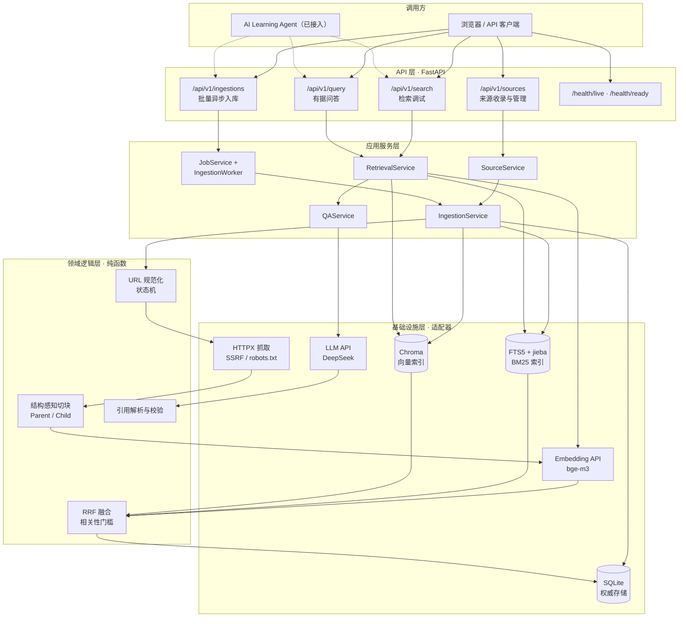

# AI Knowledge Base

面向个人 AI 学习的网页知识采集、混合检索与有据问答系统。

[](https://github.com/Rena-xie/ai_knowledge_RAG/actions/workflows/ci.yml)
[](https://www.python.org/)
[](pyproject.toml)
[](LICENSE)

## 项目简介

学习资料散落在大量公开网页中：收藏即失联、检索靠记忆、引用无出处。

本项目把这些网页变成一座**可在本地运行、可追溯来源的知识库**：

> 提交一个公开网页 URL → 抓取并提取正文 → 结构化切块 → 建立向量与全文双索引 →
> 用自然语言提问 → 得到**每条结论都能点回原文**的回答。

设计目标是"功能完整、可正常运行、数据可重建"：SQLite 是唯一权威存储，FTS5 与
Chroma 是可随时重建的派生索引；回答必须携带服务端校验过的引用；证据不足时明确
拒答，而不是让模型自由发挥。

## 核心功能

| 能力 | 实现要点 |
| --- | --- |
| **网页知识收录** | URL 规范化与去重、SSRF 防护、`robots.txt` 合规检查、同主机限速、正文提取、结构感知切块、批量向量化、双索引写入 |
| **异步入库** | 批量 URL 任务、单线程 FIFO Worker、逐条状态、失败重试、幂等键、重启恢复 |
| **来源管理** | 分页列表、详情与状态查询、错误码回传、级联删除（关系数据 + 两处派生索引）、重复 URL 幂等处理 |
| **混合检索** | Dense 向量召回 + BM25 稀疏召回并行执行，RRF 融合 + Cross-Encoder rerank，失败时回退 RRF；支持相关性门槛与融合头部保底 |
| **有据问答** | 证据按不可信输入包裹，模型只能引用上下文内标识；服务端逐条校验引用，无效引用剔除并标记；证据不足返回固定话术 |
| **可运维** | 启动自检、索引全量/按来源重建、三处数据一致性校验、数据备份、滚动日志、`request_id` 全链路追踪 |
| **工程质量** | 257 个测试、分支覆盖率 87.89%（门禁 85%）、Ruff + mypy 零错误、GitHub Actions CI |

## 系统架构



两条核心流水线：

```text
入库：URL 校验 → JobService → 单线程 Worker → 抓取/正文提取 → 结构化切块
      → Embedding → FTS5 + Chroma 写入 → 逐条状态更新
问答：问题 → Dense + BM25 双路召回 → RRF 融合 → Cross-Encoder rerank
      → 父级上下文恢复 → 相关性门槛 → LLM → 引用校验
```

### 关键设计取舍

- **权威存储与派生索引分离**：SQLite 保存来源与切块；FTS5、Chroma 均可从关系库
  全量重建，索引损坏或更换向量库不需要人工修复数据。
- **Parent / Child 两级切块**：Parent 保留章节完整性，Child 是检索与引用的最小单位；
  标题路径参与索引以提升专有名词召回，命中后恢复父级上下文避免语义割裂。
- **双路召回而不是单向量检索**：BM25 补足专有名词与代码符号（`//`、`==`、`->`），
  RRF 只使用物理排名融合，避免两路分数量纲不一致。
- **跨三处存储用补偿清理**：SQLite、FTS5、Chroma 无法原子提交，写入失败时回滚已写
  部分，宁可失败可见，也不留下"只有向量库有、关系库没有"的脏数据。
- **单机优先**：模块化单体、单线程异步入库 Worker、单进程运行；不引入 Redis/Celery
  等外部队列，用启动自检、队列上限和单 job 时间预算控制运行边界。

完整设计、状态机、错误码与 13 条架构决策记录见
[《项目开发说明_v1.md》](项目开发说明_v1.md)（基础设计）与
[《项目开发说明_v2.md》](项目开发说明_v2.md)（增量设计，冲突时以 v2 为准）。

## 项目目录

```text
.
├── app/
│   ├── main.py                 # 应用装配：路由注册、中间件、生命周期
│   ├── api/                    # HTTP 层：路由与 Pydantic 模型，不含业务逻辑
│   │   ├── sources.py          # 来源收录、列表、详情、删除
│   │   ├── ingestions.py       # 异步入库任务创建、查询、重试
│   │   ├── stats.py            # 入库任务统计
│   │   ├── search.py           # 检索调试接口
│   │   ├── query.py            # 有据问答接口
│   │   ├── health.py           # 存活 / 就绪检查
│   │   ├── middleware.py       # request_id、请求体大小限制
│   │   ├── errors.py           # 统一错误响应
│   │   └── schemas.py          # 请求 / 响应数据模型
│   ├── services/               # 应用服务层：编排业务流程
│   │   ├── source.py           # 来源生命周期与级联删除
│   │   ├── ingestion.py        # 抓取 → 解析 → 切块 → 向量化 → 双索引
│   │   ├── ingestion_jobs.py   # 批量异步任务、单线程 Worker、恢复
│   │   ├── retrieval.py        # 双路召回 → RRF → 父级上下文
│   │   ├── qa.py               # 提示词组装、引用校验、证据不足处理
│   │   ├── evaluation.py       # 检索指标计算
│   │   └── maintenance.py      # 重建索引、一致性校验、备份
│   ├── domain/                 # 领域逻辑层：纯函数，无 I/O
│   │   ├── chunking.py         # 结构感知 Parent / Child 切块
│   │   ├── rrf.py              # 倒数排名融合
│   │   ├── citations.py        # 引用解析与校验
│   │   ├── state.py            # 来源状态机
│   │   └── url.py              # URL 规范化与鉴重
│   ├── infra/                  # 基础设施层：外部依赖适配器
│   │   ├── db.py               # SQLite / SQLAlchemy
│   │   ├── fts.py              # FTS5 全文索引
│   │   ├── vector.py           # Chroma 向量索引
│   │   ├── fetcher.py          # 网页抓取与重试
│   │   ├── transport.py        # SSRF 防护：固定已校验 IP 建连
│   │   ├── robots.py           # robots.txt 检查与缓存
│   │   ├── parser.py           # 正文提取
│   │   ├── embedding.py        # Embedding API 客户端
│   │   ├── llm.py              # LLM API 客户端
│   │   └── rerank.py           # Cross-Encoder rerank 客户端
│   ├── core/                   # 配置、日志、错误码、启动自检
│   └── prompts/                # 分层提示词模板（system / user）
├── tests/
│   ├── unit/                   # 领域逻辑单测
│   ├── integration/            # 服务与 API（临时 SQLite / Chroma）
│   ├── e2e/                    # 全流水线（本地夹具 + 假外部客户端）
│   └── evals/                  # 评测语料、题库与历史结果
├── scripts/                    # 索引重建、一致性校验、备份、评测
│   ├── reindex.py
│   ├── check_consistency.py
│   ├── backup.py
│   └── run_eval.py
├── .github/workflows/ci.yml    # ruff + mypy + pytest（覆盖率门槛 85%）
├── pyproject.toml
├── uv.lock                     # 依赖完全锁定
└── .env.example                # 配置项与默认值
```

## 技术栈

| 层次 | 选型 |
| --- | --- |
| 语言与工程 | Python 3.13、uv、Ruff、mypy、pytest、GitHub Actions |
| Web 框架 | FastAPI、Uvicorn、Pydantic Settings |
| 数据存储 | SQLite + SQLAlchemy（权威）、SQLite FTS5 + jieba（BM25）、Chroma（向量） |
| 采集与解析 | HTTPX、Trafilatura |
| 外部模型 | SiliconFlow `BAAI/bge-m3`（Embedding）、`BAAI/bge-reranker-v2-m3`（rerank，v2）、DeepSeek `deepseek-flash`（生成） |

## 效果与验证

评测语料由 v1 的两个站点与 6 组官方文档/博客组成，共 166 个 URL；165 页成功入库，
4181 个 Child。题库当前为 128 题（84 个独立问题）：22 道原题 + 44 条同义改写 +
42 道官方文档题 + 20 道补充题（2026-10-20，跨章节与代码查询各 10 个新主题）。
同义改写共享同一组相关 Child，不构成独立样本；统计时应同时报告独立问题口径。

评测口径：

- **Recall@5**：前 5 条中命中的相关 Child 数 / 该题全部相关 Child 数；
- **HitRate@5**：前 5 条是否至少命中一个相关 Child；
- **Precision@5**：命中的相关 Child 数 / 5。

**rerank 对照实验（同一 `eval-kb-v3` 语料）：**

子集对照（108 题，2026-10-19/20）：

| 指标（按题加权） | rerank 开 | rerank 关 | Δ |
| --- | ---: | ---: | ---: |
| Recall@5（标准） | 0.6925 | 0.6769 | +0.0156 |
| HitRate@5 | 0.8387 | 0.7957 | +0.0430 |
| MRR@10 | 0.6814 | 0.6226 | +0.0588 |
| nDCG@10 | 0.6525 | 0.6128 | +0.0397 |
| 引用有效率 | 1.0 | 1.0 | 0 |
| 无答案识别率 | 1.0 | 1.0 | 0 |

扩展题集（128 题 / 84 个独立问题，2026-10-20）：

| 指标 | rerank 开 | rerank 关 | Δ |
| --- | ---: | ---: | ---: |
| Recall@5（按题加权） | 0.6776 | 0.6294 | +0.0482 |
| HitRate@5（按题加权） | 0.8407 | 0.7788 | +0.0619 |
| MRR@10（按题加权） | 0.6819 | 0.6016 | +0.0803 |
| nDCG@10（按题加权） | 0.6397 | 0.5736 | +0.0661 |
| Recall@5（独立问题） | 0.7464 | 0.6728 | +0.0736 |
| HitRate@5（独立问题） | 0.8650 | 0.7932 | +0.0718 |
| MRR@10（独立问题） | 0.7379 | 0.6279 | +0.1100 |
| nDCG@10（独立问题） | 0.7094 | 0.6089 | +0.1005 |
| 引用有效率 | 1.0 | 1.0 | 0 |
| 无答案识别率 | 1.0 | 1.0 | 0 |

分类（独立问题口径，128 题）：

| 类型（独立问题 / 改写题） | rerank 开 | rerank 关 | Δ |
| --- | ---: | ---: | ---: |
| 专有名词（18 / 28） | 0.7407 | 0.6204 | +0.1203 |
| 语义改写（33 / 43） | 0.8737 | 0.8434 | +0.0303 |
| 代码查询（15 / 23） | 0.7778 | 0.7222 | +0.0556 |
| 跨章节（13 / 19） | 0.3949 | 0.2551 | +0.1398 |
| 无答案（5 / 15） | — | — | — |

结论：

- rerank 在扩展题集上全面正收益：独立问题 Recall@5 +0.0736、MRR@10 +0.1100，
  专有名词与跨章节提升最大。
- 108 题子集中代码查询的 -0.3334 **只由 3 道精确字符串题造成**（q11、q11b、q25
  从 1.0 掉到 0.0），并不代表整个类别。扩展后的 23 道代码题整体只差 -0.0217，
  概念型 API 题（Depends、APIRouter、interrupt、FilesystemBackend）反而受益。
  因此应按"查询是否包含代码字面量/符号"分流，而不是按"代码查询"类别一刀切。
- v2 验收中"其他类别下降不超过 0.03"在 108 子集上未满足，在 128 题上仅差 -0.0217。
- 仍未达到 0.80：独立问题口径 0.7464，按题加权 0.6776。新增的跨章节题偏难，
  且其中 q69、q72 是标注颗粒度造成的假阴性（相关文档已检索到，命中的是其他切片），
  0.3949 应视为下界。

完整结果见
[108 题 rerank 开](tests/evals/results/2026-10-19-v2-108q-final2-standard.json)、
[108 题 rerank 关](tests/evals/results/2026-10-20-v2-108q-no-rerank.json)、
[128 题 rerank 开](tests/evals/results/2026-10-20-v2-128q-rerank.json)、
[128 题 rerank 关](tests/evals/results/2026-10-20-v2-128q-no-rerank.json)、
[独立问题口径](tests/evals/results/2026-10-20-v2-128q-rerank-grouped.json)。

真实 Agent→RAG 单链接联调（2026-10-19）已通过：FastAPI First Steps 入库 →
完成通知 → `search_knowledge` 返回 6 条证据 → 回答带 `[S1]` 引用且来源可点击。

官方来源包括 FastAPI、LangChain、LangGraph、OpenAI Cookbook、Anthropic Claude
Cookbook 与 LangChain 官方博客。OpenAI/Anthropic 主站在当前网络受地区限制或返回
403，因此使用其官方 GitHub Cookbook 的 Markdown（通过 GitHub API 读取）。新增题
由官方切块生成并人工抽查，相关 child_id 绑定到具体 chunk；跨章节题的标签已按同章节
内容补充。语料或切块规则变化后需重新标注。

**v1 检索基线（22 题，2026-10-15；历史结果，旧口径为 Any-Hit）：**

| 指标 | 结果 |
| --- | --- |
| Recall@5（旧 Any-Hit 口径） | **0.7647**（优化前 0.7059） |
| Precision@5 | 0.2235 |
| 引用有效率 | **1.0** |
| 无答案识别率 | **1.0**（优化前 0.0） |

v2 已接入 Cross-Encoder rerank（失败时回退 RRF）。工程验证（2026-10-19 本机复跑）：

| 检查 | 结果 |
| --- | --- |
| `pytest --cov` | 257 passed，分支覆盖率 **87.89%** |
| `ruff check .` | All checks passed |
| `mypy` | 51 个源文件，无错误 |

一次问答调用的响应结构（示意）：

```json
{
  "answer": "BM25 用于补足向量检索对专有名词和代码符号不敏感的问题……[S12:C57]",
  "answer_type": "answered",
  "citations": [
    {
      "source_id": 12,
      "child_id": 57,
      "title": "RAG 中的 BM25 实践",
      "url": "https://example.com/rag-bm25",
      "heading_path": "RAG / Retrieval / BM25"
    }
  ],
  "citations_validated": true,
  "usage": {"prompt_tokens": 1832, "completion_tokens": 96}
}
```

## 已知限制与路线图

V2 仍保持"单机、单用户、无前端"的边界：

- 仅监听 `127.0.0.1`，**没有鉴权**；不要直接暴露到局域网或公网。
- 无 Web 界面，通过 `/docs` 或 API 客户端操作。
- 支持批量异步入库（单 job 最多 20 个 URL）；不做站点级爬虫、定时抓取与批量站点导入。
- 生产 API 只解析静态 HTML；官方 Markdown 仅用于评测导入。不支持 PDF、图片、
  音视频与 JS 动态渲染页面。
- 标准 Recall@5 为 0.6776（按题加权）/ 0.7464（按 84 个独立问题），尚未达到 0.8
  目标；HitRate@5 为 0.8407 / 0.8650。剩余未命中集中在跨章节与专有名词，Query
  Rewrite 列为 V3 候选。
- rerank 会淹没精确字面量/符号检索（108 题子集中 q11、q11b、q25 从 1.0 掉到 0.0）。
  应按查询是否含代码字面量分流或融合 BM25 头部结果，而不是按"代码查询"类别一刀切。
- rerank 依赖外部 API，评测中有 22/108 题因接口波动 fail-open 回退 RRF；不影响可用性，
  但会限制质量上限。
- 生成侧目前只评估引用有效性与无答案识别率，尚未覆盖答案忠实性指标。

## 部署指南

### 前置要求

- Python 3.13（由 `.python-version` 锁定；uv 缺失时会自动下载对应解释器）
- [uv](https://docs.astral.sh/uv/)
- 两个外部 API Key：SiliconFlow（Embedding）与 DeepSeek（生成）。调用会产生费用。
- 主力开发与验收环境为 Windows；CI 在 Ubuntu 上执行同一套测试。

> **Chroma 路径必须是纯 ASCII**：`CHROMA_PATH` 解析为绝对路径后若包含中文等非 ASCII
> 字符，chromadb 重启后会无法读取 HNSW 索引。启动自检会直接拒绝这类配置；可把
> `CHROMA_PATH` 指向项目外的 ASCII 目录（如 `E:\ai_kb_data\chroma`）。

### 1. 获取代码并安装依赖

```powershell
git clone https://github.com/Rena-xie/ai_knowledge_RAG.git
cd ai_knowledge_RAG
uv sync --frozen
```

### 2. 配置环境变量

```powershell
Copy-Item .env.example .env
```

macOS / Linux 使用 `cp .env.example .env`。然后编辑 `.env`，至少填写：

```dotenv
EMBEDDING_API_KEY=你的 SiliconFlow Key
LLM_API_KEY=你的 DeepSeek Key
```

其余参数均有默认值，含义见 [《项目开发说明_v1.md》10.2](项目开发说明_v1.md)。`.env` 已被
`.gitignore` 排除，不会进入版本库。

> `.env.example` 默认开启 rerank；代码安全默认关闭，未配置时不会访问 rerank API。
> 未单独配置 `RERANK_API_KEY` 时会复用 Embedding Key；关闭后检索回退到 RRF 排序。

### 3. 启动服务

```powershell
uv run uvicorn app.main:app --host 127.0.0.1 --port 8000 --workers 1
```

**必须保持单进程（`--workers 1`）**：进程内入库锁与 Chroma PersistentClient 都依赖
单进程约束，多进程会导致重复入库与索引冲突。

启动时会校验必填配置，并自动完成自检（SQLite/FTS5 可用、数据目录可写），同时回收
上次中断的入库记录。任一项失败会直接拒绝启动并给出原因。

### 4. 验证部署

打开交互式文档：<http://127.0.0.1:8000/docs>

```powershell
# 健康检查
curl.exe http://127.0.0.1:8000/health/live
curl.exe http://127.0.0.1:8000/health/ready

# 收录一个公开网页（同步完成，单次预算 60 秒）
curl.exe -X POST http://127.0.0.1:8000/api/v1/sources `
  -H "Content-Type: application/json" `
  -d '{"url":"https://example.com"}'

# 基于知识库提问
curl.exe -X POST http://127.0.0.1:8000/api/v1/query `
  -H "Content-Type: application/json" `
  -d '{"question":"这个页面讲了什么？"}'
```

`/api/v1/search` 是调试接口，会返回 Dense、BM25、RRF 三组结果与耗时，便于定位检索
问题；`/api/v1/query` 返回答案、结构化引用与 `citations_validated` 标记。

> 示例使用单引号包裹 JSON（PowerShell 7 / bash 通用）。Windows PowerShell 5.1 若出现
> 引号被吞，改用 `-d "{\"url\":\"https://example.com\"}"` 或直接在 `/docs` 页面调试。

### 4.1 异步入库（v2）

v2 新增批量异步入库接口，适合 Agent 或脚本一次提交多个链接：

```powershell
curl.exe -X POST http://127.0.0.1:8000/api/v1/ingestions `
  -H "Content-Type: application/json" `
  -d '{"urls":["https://example.com/a","https://example.com/b"]}'

curl.exe "http://127.0.0.1:8000/api/v1/ingestions/{job_id}?wait_seconds=10"
```

- 有实际入库项返回 `202`，全部重复或无需处理返回 `200`。
- job 状态为 `queued / running / completed / partial / failed`，失败项带 `error_code`。
- 可选 `Idempotency-Key` 请求头，防止重复提交。
- 与 Learning Agent 同机运行时，建议 RAG 使用 `8001`、Agent 使用 `8000`。

刷新来源与查看统计：

```powershell
# 重新抓取并替换指定来源（内容未变化时只更新 last_checked_at）
curl.exe -X POST http://127.0.0.1:8000/api/v1/sources/12/refresh

# 近 24 小时任务统计
curl.exe "http://127.0.0.1:8000/api/v1/stats/ingestions?since_hours=24"
```

### 5. 常用运维命令

```powershell
# 从 SQLite 全量重建派生索引（也可 --source-id 3 只重建单个来源）
uv run python scripts/reindex.py

# 校验三处数据的 child_id 集合是否一致，不一致时退出码为 1
uv run python scripts/check_consistency.py

# 备份 SQLite 与 Chroma（建议先停服）
uv run python scripts/backup.py --target backups

# 运行检索与引用评测（会写入独立评测库，可重复执行）
uv run python scripts/run_eval.py
```

### 6. 运行测试

```powershell
uv run pytest -q
uv run pytest --cov --cov-report=term-missing
uv run ruff check .
uv run mypy
```

### 7. 常见问题

| 现象 | 原因与处理 |
| --- | --- |
| `uv trampoline failed to canonicalize script path` | 项目目录被移动/重命名导致 `.venv` 启动器失效。删除 `.venv` 后重新执行 `uv sync`（由 `uv.lock` 完整复现）。 |
| 启动时报 Chroma 路径含非 ASCII | 将 `CHROMA_PATH` 指向纯 ASCII 目录后重启。 |
| 入库返回 `INGEST_BUSY` | V1 入库串行，等待当前任务完成后重试。 |
| 页面抓取返回 `ROBOTS_DISALLOWED` | 目标站点 `robots.txt` 禁止抓取，属于预期行为。 |
| 问答返回 `insufficient_evidence` | 检索最高相似度低于 `MIN_DENSE_SIMILARITY`（默认 0.58）；确认库内已收录相关内容，换 Embedding 模型后需重新校准该阈值。 |

## 文档与许可

- 架构、接口契约、状态机与决策记录：[项目开发说明_v1.md](项目开发说明_v1.md)
- V2 开发计划与验收标准：[项目开发说明_v2.md](项目开发说明_v2.md)
- 运维脚本说明：[scripts/README.md](scripts/README.md)
- 评测集说明：[tests/evals/README.md](tests/evals/README.md)

本项目以 [MIT 许可证](LICENSE) 开源。
