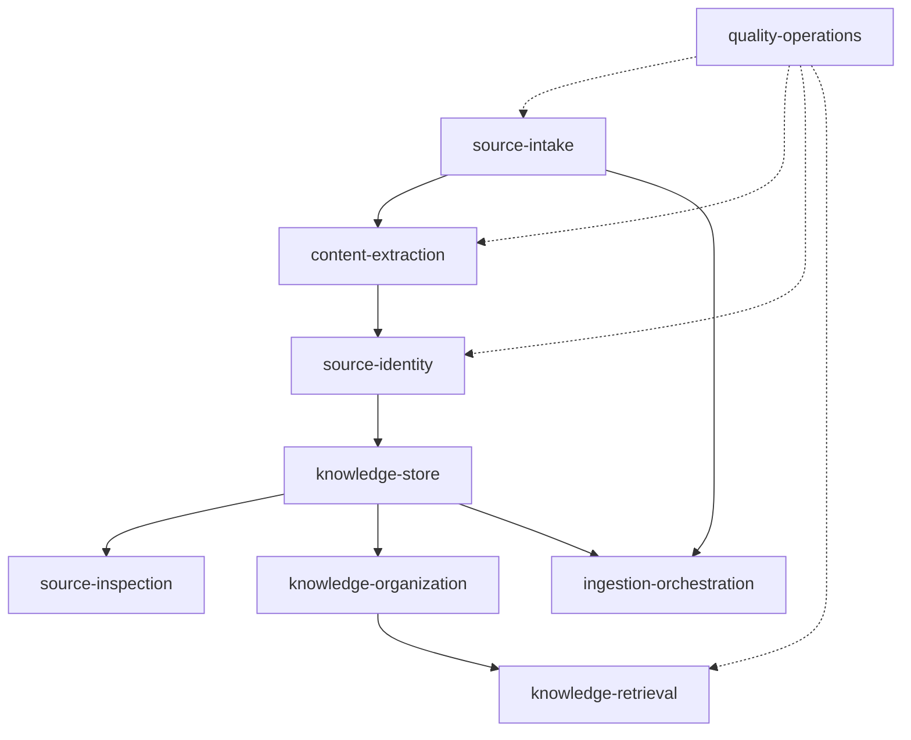

# v2 阶段复盘与剩余模块架构提案

| 项目 | 内容 |
| --- | --- |
| 日期 | 2026-10-25 |
| 基线 | `main` / `cf0d00d` |
| 依据 | `PROJECT.md`、`项目开发说明_v2.md`、当前代码、测试和评测产物 |
| 状态 | 等待方案评审；不进入实现 |

## 1. 阶段复盘

### 1.1 已完成并可用

| 能力 | 当前实现 | 证据 |
| --- | --- | --- |
| URL 收录 | 同步入口、异步 Job、批量 URL | `app/api/sources.py`、`app/api/ingestions.py` |
| 抓取与安全 | HTTPX、SSRF、robots、体积和重定向限制 | `app/infra/fetcher.py` |
| 解析与切块 | Trafilatura、Parent/Child 结构化切块 | `app/infra/parser.py`、`app/domain/chunking.py` |
| 权威与派生存储 | SQLite、FTS5、Chroma | `app/infra/db.py`、`app/infra/fts.py`、`app/infra/vector.py` |
| 混合检索 | Dense、BM25、RRF、rerank、字面量提权、单路降级 | `app/services/retrieval.py` |
| 任务可靠性 | 单线程 Worker、失败隔离、重试、启动恢复 | `app/services/ingestion_jobs.py` |
| 维护 | 重建、一致性检查和备份 | `app/services/maintenance.py` |
| 职责边界 | RAG 不调用 LLM，不提供 `/query` | `app/main.py`、`app/core/settings.py` |

删除 LLM 链路后，相关受影响测试和全量 pytest 已通过；Ruff 已通过。覆盖率、mypy 和真实外部
API 评测本轮未重新执行。收到停止测试指令后未再运行测试。

### 1.2 尚未完成

| 主题 | 当前差距 | 对 v2 的影响 |
| --- | --- | --- |
| 来源身份 | 只按输入 URL 鉴重，没有最终 URL、别名和身份冲突处理 | 重定向、AMP、打印版和镜像无法可靠合并 |
| 正文去重 | 没有跨 URL 正文指纹去重 | 同一正文可能生成多份 Parent/Child 与索引 |
| 内容质量 | 没有中英文黄金集和量化门槛 | 只能证明检索，不能证明正文提取正确 |
| 双语支持 | 缺少独立的中英文检索验收集 | 英文支持尚未形成可回归证据 |
| 来源预览 | 没有正文/Parent/Child 只读 API | 用户无法确认实际入库内容 |
| 知识组织 | 没有集合、标签和范围过滤 | 所有资料仍只能作为单一总库使用 |
| 过滤检索 | FTS/Chroma 查询没有来源范围条件 | 无法在召回阶段正确限定集合或标签 |
| 刷新 | 没有 `changed` 字段，失败状态有歧义 | Agent 无法判断内容是否变化 |
| 幂等 | 幂等键永久唯一，规格要求 24 小时 | 长期行为与契约不一致 |
| 观测 | Job 关联日志字段未输出，统计缺失败分布 | 难以按任务排查和运营 |
| 安全边界 | 未知异常原文可进入错误信息 | 可能泄露内部路径或上游内容 |
| 重建 | 缺少在线锁和失败回退边界 | 重建失败可能留下部分派生索引 |
| 启动检查 | 空密钥等无效配置未拒绝 | 错误延后到首次外部调用才暴露 |

### 1.3 范围校正

1. v2 已正式收敛为“RAG 只提供证据”，不实现问答和 LLM。
2. 历史重复来源不自动合并，只约束升级后的新入库和刷新。
3. `INGEST_ALLOWED_HOSTS` 在规格中是可选能力，当前没有实际调用方。
4. 内容预览只读，不提供人工编辑。
5. 多集合、标签、中英文、最终 URL 和正文去重属于已确认的 v2 范围。

### 1.4 复盘门禁结论

- 下一阶段的前置条件成立：RAG/Agent 边界已稳定，可以继续完善知识库能力。
- 不建议先做 UI、定时抓取、PDF、查询改写或更多检索算法。
- 应先完成数据身份、正文质量和组织模型，再做依赖它们的高级检索验收。
- `INGEST_ALLOWED_HOSTS` 建议移出当前 v2 阻塞范围，留到出现真实域名限制需求时实现。

## 2. 架构提案

### 2.1 模块边界

| 模块 ID | 职责 | 依赖 |
| --- | --- | --- |
| `source-intake` | URL 输入、抓取、最终 URL 获取、安全限制 | — |
| `content-extraction` | 标题、正文、结构块和多语言元数据 | `source-intake` |
| `source-identity` | 最终 URL、别名、正文指纹、冲突与重复判定 | `content-extraction` |
| `knowledge-store` | 来源、Parent/Child、关系数据与生命周期 | `source-identity` |
| `source-inspection` | 正文、Parent/Child 和来源元数据只读查询 | `knowledge-store` |
| `knowledge-organization` | 多集合、标签、来源关联和过滤范围解析 | `knowledge-store` |
| `knowledge-retrieval` | Dense/BM25 召回、RRF、rerank 和范围过滤 | `knowledge-store`、`knowledge-organization` |
| `ingestion-orchestration` | Job/Item、单线程执行、失败隔离和恢复 | `source-intake`、`knowledge-store` |
| `quality-operations` | 内容质量、检索评测、双语、观测和故障注入 | 全链路 |

### 2.2 依赖图



### 2.3 数据模型

目标 schema 为 v4。新增或调整：

```text
knowledge_sources
  final canonical_url
  content_hash
  fingerprint_version
  language_code

source_aliases
  source_id, url, normalized_url UNIQUE, alias_type

knowledge_collections
  id, name UNIQUE, description, is_default, timestamps

knowledge_collection_sources
  collection_id, source_id

tags
  id, name UNIQUE

source_tags
  source_id, tag_id

job_idempotency_keys
  key, bucket_start, job_id
  UNIQUE(key, bucket_start)
```

关键设计：

- 当前最终 URL 是 `knowledge_sources.canonical_url` 的唯一身份。
- 提交 URL、重定向 URL、HTML canonical/AMP 线索和历史最终 URL 进入 `source_aliases`。
- 正文指纹使用独立规范化版本，不把现有输入 URL hash 当作新版指纹。
- 一个来源可属于多个集合和多个标签。
- 默认集合承载历史来源和未指定集合的新来源。
- 历史重复来源不自动合并。
- 幂等键使用 24 小时时间桶登记；`ingestion_jobs.idempotency_key` 保留为历史审计字段，但不再作为永久唯一身份。

### 2.4 历史数据兼容

现有数据不能可靠反推出最终 URL 或新版正文指纹：

- 迁移时保留当前 `canonical_url`，标记其身份尚未在本次迁移中重新验证。
- 在来源下次刷新时补齐最终 URL、别名和新版正文指纹。
- 不在迁移阶段批量访问外网。
- 现有 `content_hash` 可作为 legacy 指纹参与同 URL 刷新判断，但不据此自动删除历史来源。
- 迁移必须只备份、建表、回填默认集合和补充新字段，不做不可逆合并。

### 2.5 正文质量管线

```text
HTML
  → 正文和结构提取
  → 语言元数据判定
  → Markdown 规范化
  → 正文指纹
  → 黄金集质量校验
```

建议：

- 语言检测仅用于元数据和分语言评测，不让两套检索链路按语言分叉。
- 语言值使用 `zh`、`en`、`mixed`、`unknown`；采用确定性字符统计，不新增模型依赖。
- 黄金集覆盖中文、英文、混合语言、代码、表格、列表和长章节。
- 解析器变更先测基线，再调整规则，不先假定 Trafilatura 有问题。

### 2.6 去重流程

```text
提交 URL
  → 规范化
  → 抓取并得到最终 URL
  → 查询最终 URL/别名
  → 解析、清洗、计算正文指纹
  → 查询既有正文指纹
  → 命中：复用来源、追加别名和集合/标签
  → 未命中：写入 Parent/Child 与双索引
```

约束：

- 单进程入库锁保证去重检查与写入之间不会并发穿透。
- 同一最终 URL、不同正文视为身份冲突，不覆盖。
- 刷新得到的正文若与另一来源指纹相同，应失败并保留旧数据。
- 不实现模糊相似度或自动策略判断“近似同一篇”。

### 2.7 集合、标签与检索过滤

过滤范围在召回前解析：

```text
search filter
  → SQLite 解析允许的 source_id 集合
  → Dense 查询限定 source_id
  → FTS 查询限定 child/source
  → RRF
  → rerank 与上下文
```

语义：

- 不指定过滤：搜索全部来源。
- 多集合：并集。
- 多标签：全部满足。
- 集合、标签、source_id 条件之间：交集。
- 空允许集合：直接返回空证据，不执行无过滤召回。

### 2.8 来源预览

新增只读查询服务：

```text
SourceInspectionService
  → 来源元数据
  → Parent 分页
  → 每个 Parent 下的 Child
  → 最终 URL、别名、集合和标签
```

该服务只读取 SQLite 权威数据，不依赖 Chroma/FTS，不提供修改能力。

### 2.9 错误、观测和恢复

- 未知异常只向 API 返回稳定错误码和安全摘要，原始异常仅写日志。
- JSON 日志白名单增加 `job_id`、`item_id`、`client_run_id`。
- `/search` 暴露 `degraded_routes`。
- 统计接口增加成功率和错误码分布。
- 幂等键按 24 小时窗口解释；过期后允许新 Job。
- 重建命令增加进程内互斥和明确失败恢复说明。
- 启动自检拒绝空 Embedding Key 等无效配置。

## 3. 实施阶段

### Phase 1: 数据基础与来源身份

1. schema v4 迁移与默认集合。
2. 最终 URL 与来源别名。
3. 正文指纹与新入库去重。

**Checkpoint A：** 迁移副本、URL 身份、去重和刷新冲突测试通过。

### Phase 2: 内容质量与双语

4. 中英文正文黄金集与基线。
5. 语言元数据。
6. 基于黄金集修正解析器。

**Checkpoint B：** 内容质量达到已确认阈值，中英文结构样本通过。

### Phase 3: 预览与组织

7. 来源正文/Parent/Child 预览。
8. 集合和标签服务。
9. 集合/标签 API 与来源关联。

**Checkpoint C：** 用户可以查看内容并完成组织，不触发重新 Embedding。

### Phase 4: 过滤检索与双语评测

10. Dense/FTS 召回阶段过滤。
11. `/search` 过滤契约和降级字段。
12. 中英文检索评测集。

**Checkpoint D：** 过滤结果正确，中英文分别达到批准目标。

### Phase 5: 可靠性与可观测性

13. 异常脱敏与 Job 日志关联。
14. 幂等窗口与启动配置校验。
15. 统计与重建可靠性。

**Checkpoint E：** 安全、观测、恢复和门禁检查通过。

### Phase 6: 迁移与发布验收

16. 真实数据副本迁移、备份恢复和回滚演练。
17. 文档、历史结果说明和最终验收。

**Checkpoint Complete：** v2 所有 Must 条件和发布门禁通过。

### 可并行与必须串行

- 可并行：Task 4 的内容黄金集是测试资产，可与 Task 1–3 并行建设。
- 必须串行：schema v4、来源身份、去重、组织、过滤检索和迁移验收。
- 需要契约先冻结：Task 9 与 Task 11 共享过滤语义，API 契约应先确认。

## 4. 风险与缓解

| 风险 | 影响 | 缓解 |
| --- | --- | --- |
| schema v4 迁移破坏旧数据 | 高 | 备份、副本迁移、dry-run、回滚演练 |
| 现有来源无法立即得到最终 URL | 中 | 迁移保留 legacy 身份，刷新时补齐 |
| 去重误合并不同内容 | 高 | 只做规范化正文完全相等判定 |
| 过滤后候选不足 | 中 | 在召回阶段过滤，必要时扩大候选池 |
| Chroma metadata 过滤限制 | 中 | 先用来源级别过滤，以 SQLite 解析允许来源 |
| 双语效果不均衡 | 中 | 分语言黄金集、题库和指标 |
| 修改解析器造成回归 | 中 | 先建黄金集，再做小步调整 |
| 任务过多导致跨模块混合 | 高 | 按纵向切片实施，每 3 项设检查点 |

## 5. 需要评审确认的决策

1. **历史来源延迟补齐身份**：迁移不访问外网，现有来源的最终 URL 和新版正文指纹在下次刷新时补齐。
2. **可选域名白名单延后**：将 `INGEST_ALLOWED_HOSTS` 从当前 v2 阻塞范围移到后续版本，除非现在已有明确使用场景。

以上两点确认后，按 `tasks/todo.md` 中 19 个任务实施。
