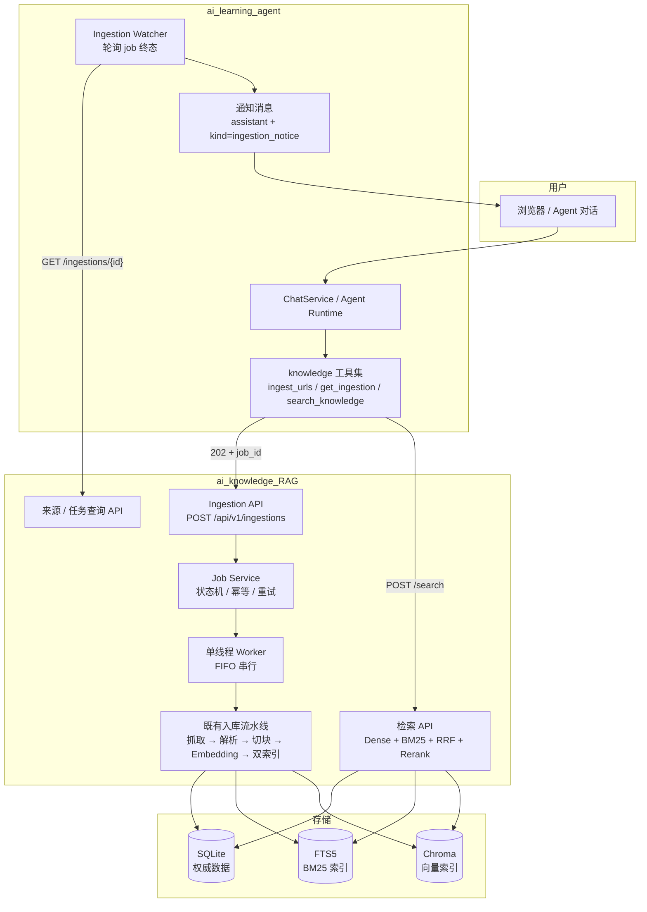

# AI Knowledge Base v2 项目开发说明

> **文档定位**：本文是 v2 的开发指导与验收基线，定义相对 v1 的增量契约。
> v1 的《项目开发说明_v1.md》继续对既有接口、状态机、错误码与安全边界有效；两者冲突时，
> 本文只覆盖 v2 明确变更的部分，其余仍以《项目开发说明_v1.md》为准。v2 完成后，把本文
> 的有效内容合并回主文档并归档。
>
> **约束分级**：
> - **【契约】**：对外行为、数据不变量、安全边界，改动前先改本文。
> - **【默认】**：可调参数与策略默认值。
> - **【建议】**：推荐实现方式，可用更好的方案替换并记录。
> - **【决策】**：已确定的取舍及理由。
>
> **适用仓库**：
> - `ai_knowledge_RAG`：知识采集、切块、索引、检索服务。
> - `ai_learning_agent`：对话、Agent Runtime、工具编排与通知。
>
> **版本**：v2.0-draft　**日期**：2026-10-19

## 摘要（30 秒）

- **v2 目标**：把 RAG 从"可独立运行的单体应用"升级为"Learning Agent 可调用的个人学习知识库服务"。
- **确认范围**：单用户、静态文档/博客为主、一个总库、异步入库、完成/异常主动通知、v2 同时做 rerank 与 50+ 题评测。
- **核心链路**：发链接 → Agent 调 `ingest_urls` → RAG 创建 job 并返回 202 → 后台 Worker 串行入库 → Agent watcher 收到终态 → 在对话中回复"已完成/失败" → 用户提问时 `search_knowledge` 返回证据并由 Agent 生成带引用回答。
- **明确不做**：换数据库、RAG 前端、多用户/鉴权、PDF/视频、JS 渲染、MCP、多轮 RAG、知识图谱。
- **关键决策**：保留 SQLite + Chroma；API 异步但 Worker 串行；Agent 侧轮询 watcher 负责通知；Agent 用自己的 `[S1]` 引用体系，不直接透传 RAG 的 `[S12:C57]`。

## 1 背景与确认结论

### 1.1 用户与场景

目标用户是单一使用者，在本机通过 Learning Agent 学习技术文档与博客。用户希望：

1. 在 Agent 对话中直接发链接，不必切换到 RAG 的 API 或 `/docs`。
2. 链接内容自动完成获取、清洗、切块、向量化与入库。
3. 入库开始时立即得到反馈，完成后收到"已完成入库"的消息；失败时收到可读的失败原因。
4. 后续可以在 Agent 中基于知识库提问，并看到可点击的来源。

### 1.2 已确认的范围

| 项目 | 确认结果 | 对设计的影响 |
| --- | --- | --- |
| 用户规模 | 单用户、本机 | 不做鉴权、多租户、配额；继续监听 `127.0.0.1` |
| 内容类型 | 静态文档、博客为主 | v2 只处理 HTML；PDF/JS 渲染/视频后置 |
| 知识组织 | 暂时一个总库 | 不引入 collection/tag；检索默认全库 |
| 入库交互 | 返回"已开始"，完成或异常后主动通知 | 必须有 job + Agent watcher + 持久化通知 |
| 检索质量 | v2 同时做 rerank + 扩题库到 50+ | rerank 进入 v2 主线，不作为可选优化 |

### 1.3 v2 目标

1. **可编排**：Agent 能通过稳定、窄的 HTTP 工具契约完成入库、查进度、检索。
2. **可观察**：任何一次入库都有 job、逐条状态、错误码与阶段耗时。
3. **可信**：回答中的每条引用都能回到 RAG 中真实的来源与切块，不出现裸 `[S12:C57]`。
4. **可评估**：Recall@5 达到 0.8 以上，引用有效率保持 1.0，无答案识别率不低于 0.9。

### 1.4 v2 非目标（范围冻结）

- 不做多用户、账号、鉴权、HTTPS 与远程访问。
- 不做 RAG 自己的 Web 前端；Agent 是唯一交互入口。
- 不做 PDF、Office、图片、音视频、JS 动态渲染。
- 不做站点级爬虫、定时增量抓取、批量站点导入。
- 不做 MCP Server、GraphRAG、知识图谱、答案缓存。
- 不做多轮 RAG；多轮上下文由 Agent 负责。
- 不做分布式队列、Redis、Celery、Postgres、Qdrant。

## 2 现状与差距

| 能力 | v1 现状 | v2 差距 | 对应工作项 |
| --- | --- | --- | --- |
| 入库接口 | `POST /sources` 同步、单 URL、60 秒预算 | Agent 工具调用会被长时间占用；无法批量 | R01–R03 |
| 入库执行 | 单锁、串行、失败即整次失败 | 缺少 job 级状态、逐条失败隔离、恢复与重试 | R02、R04 |
| 完成通知 | 无 | 只能主动轮询；无法"完成后回复" | A04–A06 |
| 检索质量 | Dense + BM25 + RRF，Recall@5 0.7647 | 语义改写与长文档定位不足 | R05–R07 |
| 引用体系 | RAG 用 `[S12:C57]`；Agent 用 `[S1]` | 直接透传会导致引用不可点击或残留 | A07–A09 |
| 工具契约 | Agent 一次工具调用只登记一个来源 | 多条证据无法逐条引用 | A08 |
| 来源更新 | 重复 URL 直接返回既有记录 | 内容变化后无法刷新 | R08 |
| 可观测性 | 请求日志、来源状态 | 缺 job 维度、阶段耗时、跨服务关联 | R09、A10 |
| 并发模型 | 单进程、单写者 | 与"异步"不冲突；不需要换存储 | 本文第 3 章 |

## 3 数据库与并发决策

### 3.1 结论【决策】

**v2 保留 SQLite + FTS5 + Chroma，不更换数据库。**

异步化不等于并发化。v2 只需要把"请求等待入库完成"改成"请求创建 job 后立即返回"，
后台仍然由一个 Worker 串行执行入库。

### 3.2 理由

1. **瓶颈不在数据库**：单页入库的主要耗时是网络抓取、正文解析与 Embedding API；
   SQLite 写入只有来源记录、Parent/Child 行与少量状态更新。
2. **SQLite 的并发模型足够**：WAL 模式允许"一个写者 + 多个读者"；
   本项目写操作短且集中，`busy_timeout` 已配置。
3. **Chroma PersistentClient 是嵌入式单进程组件**：引入多 Worker 进程会直接破坏索引一致性；
   换服务型向量库会新增部署、备份、监控与内存成本。
4. **单用户没有吞吐压力**：一天几十到几百个页面，串行完全够用；串行还能天然满足
   robots.txt 的同主机限速与 Embedding 配额控制。
5. **迁移成本与收益不匹配**：Postgres/Qdrant 需要额外服务与运维；当前 12G 内存也不适合
   再常驻一套数据库。
6. **派生索引可重建**：即使未来更换向量库，也可以从 SQLite 权威数据重建，不存在锁定。

### 3.3 v2 并发模型【契约】

- API 进程：接收请求、校验、创建 job、返回 202；不执行抓取与 Embedding。
- 后台 Worker：单线程、FIFO、串行执行 job；同一时刻只处理一个 item。
- 读请求：检索与问答可以并发，不阻塞 Worker。
- 单进程启动：RAG 仍固定 `--workers 1`；这是 Chroma 与 SQLite 单写者的硬约束。

### 3.4 何时重新评估存储

出现以下任一条件时，再评估 Postgres + pgvector / Qdrant：

- 需要多用户、远程访问或多进程 Worker；
- 切片规模超过约 10 万–100 万且写入频繁；
- 需要跨机器部署、水平扩展或高可用；
- 入库吞吐成为可测量的瓶颈，且确认不是网络/API 限制。

在此之前，换库属于过度设计。

## 4 目标架构



### 4.1 服务边界

| 服务 | 负责 | 不负责 |
| --- | --- | --- |
| Agent | 对话、意图识别、工具编排、通知、最终回答与引用 | 抓取、解析、切块、向量化 |
| RAG | 入库任务、抓取合规、切块、索引、检索、证据 | 对话历史、用户界面、通知文案 |
| SQLite | 来源、切块、job、索引元数据 | 向量检索 |
| FTS5 / Chroma | 派生索引，可重建 | 权威数据 |

### 4.2 端口约定【默认】

- Agent：`127.0.0.1:8000`
- RAG：`127.0.0.1:8001`

两个项目当前都默认 8000，v2 必须显式配置，避免冲突。建议在各自的 `.env.example`
与 README 中固定该约定。

## 5 数据模型变更

### 5.1 RAG：`ingestion_jobs`【契约】

| 字段 | 类型 | 约束 | 说明 |
| --- | --- | --- | --- |
| id | TEXT | 主键 | `job_` + ULID/UUID，对外暴露 |
| status | TEXT | NOT NULL | `queued/running/completed/partial/failed` |
| total_items | INTEGER | NOT NULL | 去重后的 URL 数 |
| succeeded_items | INTEGER | NOT NULL DEFAULT 0 | 成功数（completed） |
| failed_items | INTEGER | NOT NULL DEFAULT 0 | 失败数 |
| skipped_items | INTEGER | NOT NULL DEFAULT 0 | 跳过的 URL 数 |
| client_run_id | TEXT | NULL | Agent 的 run_id，用于串联日志 |
| idempotency_key | TEXT | UNIQUE, NULL | 请求幂等键 |
| error_code | TEXT | NULL | job 级失败原因（仅整体失败时） |
| created_at | TEXT | NOT NULL | UTC ISO-8601 |
| started_at | TEXT | NULL | |
| finished_at | TEXT | NULL | |

索引：`(created_at)`、`(status, created_at)`、`(idempotency_key)`。

### 5.2 RAG：`ingestion_job_items`【契约】

| 字段 | 类型 | 约束 | 说明 |
| --- | --- | --- | --- |
| id | INTEGER | 主键自增 | |
| job_id | TEXT | FK → ingestion_jobs.id, ON DELETE CASCADE | |
| url | TEXT | NOT NULL | 用户提交的原始 URL |
| canonical_url | TEXT | NOT NULL | 规范化后的 URL |
| status | TEXT | NOT NULL | `queued/running/completed/failed/skipped` |
| source_id | INTEGER | FK → knowledge_sources.id, NULL | 已创建的来源 |
| title | TEXT | NULL | 入库后回填 |
| error_code | TEXT | NULL | 复用 v1 错误码 |
| error_message | TEXT | NULL | 短文案，不含密钥与正文 |
| attempts | INTEGER | NOT NULL DEFAULT 0 | Worker 执行次数 |
| created_at | TEXT | NOT NULL | |
| started_at | TEXT | NULL | |
| finished_at | TEXT | NULL | |

索引：`(job_id, id)`、`(status)`、`(canonical_url)`。

### 5.3 RAG：`knowledge_sources` 增量字段

新增 `last_checked_at TEXT NULL`：最近一次刷新检查时间，用于 v3 定时刷新与
"内容未变化"的审计。v1 的字段与状态机不变。

### 5.4 Agent：`ingestion_watches`【契约】

| 字段 | 类型 | 约束 | 说明 |
| --- | --- | --- | --- |
| id | INTEGER | 主键自增 | |
| job_id | TEXT | UNIQUE, NOT NULL | RAG 的 job id |
| conversation_id | TEXT | FK → conversations.id, ON DELETE CASCADE | 通知投递到哪个对话 |
| status | TEXT | NOT NULL | `watching/notified/failed` |
| attempts | INTEGER | NOT NULL DEFAULT 0 | 轮询次数 |
| last_checked_at | DATETIME | NULL | |
| next_check_at | DATETIME | NOT NULL | 下一次轮询时间，支持退避 |
| notified_at | DATETIME | NULL | 保证只通知一次 |
| last_error | TEXT | NULL | 内部错误摘要，不展示给用户 |
| created_at | DATETIME | NOT NULL | |

索引：`(status, next_check_at)`、`(conversation_id)`。

### 5.5 Agent：`messages` 增量字段

新增 `kind TEXT NOT NULL DEFAULT 'chat'`：

- `chat`：普通用户/助手消息。
- `ingestion_notice`：入库完成/失败的系统通知。

通知消息的 `run_id` 为 `NULL`，不创建新的 AgentRun，不消耗模型 token。

### 5.6 Agent：`document_snapshots` 增量字段

新增 `provider TEXT NOT NULL DEFAULT 'fetch'`：

- `fetch`：`fetch_document` 实时抓取。
- `knowledge_base`：`search_knowledge` 返回的证据片段。

用于 UI 区分"刚抓的网页"与"知识库召回"，并为引用展示提供来源类型。

### 5.7 迁移策略【契约】

RAG：

1. `SCHEMA_VERSION` 从 `"1"` 升到 `"2"`。
2. 启动时执行幂等迁移：新表用 `create_all` 创建；`knowledge_sources.last_checked_at`
   通过 `PRAGMA table_info` 检查后 `ALTER TABLE` 添加。
3. 迁移前必须调用现有备份脚本生成 SQLite 快照；迁移失败时保留备份并拒绝启动。
4. 迁移必须支持"从 v1 真实库升级"，测试中构造 v1 schema + 数据后执行。

Agent：

1. 使用现有 Alembic，新增 `0002_ingestion_watch.py`。
2. 迁移包含：`ingestion_watches` 表、`messages.kind`、`document_snapshots.provider`。
3. 启动时自动迁移的行为保持不变。

## 6 RAG API 契约

### 6.1 创建入库任务

`POST /api/v1/ingestions`

请求：

```json
{
  "urls": [
    "https://example.com/a",
    "https://example.com/b"
  ],
  "client_run_id": "run_01J..."
}
```

> `force_refresh` 与来源刷新在 M6 一起启用；M1 不接受该字段，避免出现
> "接口接受但实际不生效"的假契约。

约束：

- `urls` 去空白、去空项、按规范化 URL 去重，保留首次出现顺序。
- 单次最多 20 个 URL；超过返回 `400 TOO_MANY_URLS`。
- 已完成的 URL 在 M1 记为 `skipped`；M6 再增加 `force_refresh` 重新抓取。
- 可选请求头 `Idempotency-Key`；相同 key 在 24 小时内返回既有 job，不重复执行。

响应：

- 有实际入库项：`202 Accepted`
- 全部为 skipped：`200 OK`

```json
{
  "job_id": "job_01J...",
  "status": "queued",
  "total": 2,
  "accepted": 2,
  "skipped": [],
  "created_at": "2026-10-19T08:00:00Z"
}
```

含 skipped 时：

```json
{
  "job_id": "job_01J...",
  "status": "completed",
  "total": 2,
  "accepted": 1,
  "skipped": [
    {
      "url": "https://example.com/a",
      "reason": "already_indexed",
      "source_id": 12
    }
  ],
  "created_at": "2026-10-19T08:00:00Z"
}
```

### 6.2 查询任务

`GET /api/v1/ingestions/{job_id}?wait_seconds=0`

- `wait_seconds` 范围 0–25；用于其他客户端长轮询，Agent 的 watcher 默认为 0。
- 任务不存在返回 `404 JOB_NOT_FOUND`。

```json
{
  "job_id": "job_01J...",
  "status": "running",
  "total": 3,
  "succeeded": 1,
  "failed": 0,
  "skipped": 0,
  "created_at": "2026-10-19T08:00:00Z",
  "started_at": "2026-10-19T08:00:01Z",
  "finished_at": null,
  "items": [
    {
      "url": "https://example.com/a",
      "canonical_url": "https://example.com/a",
      "status": "completed",
      "source_id": 12,
      "title": "示例文章",
      "error_code": null,
      "error_message": null,
      "started_at": "2026-10-19T08:00:01Z",
      "finished_at": "2026-10-19T08:00:18Z"
    }
  ]
}
```

`items` 最多返回 50 条；单 job 最多 20 个 URL，因此 M1 正常都会完整返回。
`items_truncated` 保留给后续批次扩容。

### 6.3 任务列表与重试

- `GET /api/v1/ingestions?status=&page=1&size=20`：按创建时间倒序。
- `POST /api/v1/ingestions/{job_id}/retry`：只对 `failed` items 创建**新 job**，
  原 job 历史不被修改；无失败项返回 `409 JOB_NOT_RETRYABLE`。

### 6.4 来源刷新

`POST /api/v1/sources/{source_id}/refresh`

- 创建一个 `force_refresh=true` 的单条 job，返回 202。
- 内容未变化：只更新 `last_checked_at`，item 状态 `completed`，`changed=false`。
- 内容变化：重建该来源的 Parent/Child、FTS5 与 Chroma；失败时保留旧数据。

### 6.5 状态机【契约】

Job：

```text
queued → running → completed   （全部成功或 skipped）
                 → partial     （至少一条成功，至少一条失败）
                 → failed      （全部失败）
```

Item：

```text
queued → running → completed
                 → failed
        → skipped（创建时或执行前判定）
```

- 除 retry 创建新 job 外，终态不可回退。
- `partial` 必须能通过 `items` 看到具体失败项。

### 6.6 错误码增量

| 错误码 | HTTP | 场景 |
| --- | --- | --- |
| `JOB_NOT_FOUND` | 404 | job id 不存在 |
| `JOB_NOT_RETRYABLE` | 409 | 没有可重试的失败项 |
| `TOO_MANY_URLS` | 400 | 单次超过 20 个 URL |
| `INGESTION_QUEUE_FULL` | 429 | 待处理队列达到上限 |

Item 级失败继续使用 v1 的 `FETCH_TIMEOUT`、`ROBOTS_DISALLOWED`、
`EMBEDDING_FAILED`、`INDEX_WRITE_FAILED` 等错误码，不新增重复语义。

### 6.7 兼容性

- `POST /api/v1/sources`、`GET /api/v1/sources`、`DELETE /api/v1/sources/{id}`、
  `/search`、`/query`、`/health/*` 的行为保持不变。
- 新接口使用 `/api/v1/ingestions`，不破坏 v1 客户端。
- README 与《项目开发说明_v1.md》在 v2 完成后把同步 `/sources` 标注为"兼容入口，
  推荐使用异步任务接口"。

## 7 入库 Worker

### 7.1 执行模型【契约】

- 单进程、单线程、FIFO 队列；同一时刻只处理一个 item。
- Worker 启动时从数据库恢复：
  - `running` 的 item → `failed`，错误码 `INGEST_INTERRUPTED`；
  - `queued` 的 item → 重新入队；
  - 对应 job 状态回到 `queued`，继续执行剩余项。
- 优雅关闭：停止取新 job，等待当前 item 结束（受 `INGEST_TIMEOUT_S` 约束），
  未开始项保持 `queued`，下次启动继续。
- 队列上限 100 个待处理 job（单 job 最多 20 个 URL）；超过返回
  `429 INGESTION_QUEUE_FULL`。

### 7.2 复用既有流水线

Worker 直接调用现有 `IngestionService._run_pipeline` 的内部能力，不复制抓取、
切块或索引代码。建议把 `IngestionService` 拆出一个 `ingest_source(source_id, url)`
入口，供同步 API 与 Worker 共用。

### 7.3 失败隔离

- 单个 item 抛错只把该 item 标记 `failed`，不终止 job。
- 捕获 `AppError` 时写入 `error_code` 与安全文案；未知异常记 `INTERNAL_ERROR`，
  日志保留 traceback，但不返回给 Agent。
- 现有抓取/Embedding 内部重试保持不变；v2 不做 job 级自动重试，避免重复计费。
- 手动重试通过 `POST /ingestions/{job_id}/retry` 创建新 job。

### 7.4 预算

- 单 item 仍受 `INGEST_TIMEOUT_S=60` 约束。
- 单 job 总预算 `INGESTION_JOB_TIMEOUT_S=1800`；超过后剩余 item 标记
  `INGEST_TIMEOUT`，job 置为 `partial/failed`（M1 已实现）。
- Worker 日志记录每个阶段的 `duration_ms`。

## 8 Agent 工具接入

### 8.1 工具清单【契约】

新增 `src/learning_agent/tools/knowledge/`，注册四个工具：

| 工具 | 参数 | 返回 |
| --- | --- | --- |
| `ingest_urls` | `urls: list[str]`、`force_refresh: bool = false` | `job_id`、`status`、`accepted`、`skipped` |
| `get_ingestion` | `job_id: str` | job 状态、成功/失败数、失败原因 |
| `list_sources` | `limit: int = 10` | 最近来源的标题、URL、状态、切块数 |
| `search_knowledge` | `question: str`、`top_k: int = 5` | 证据列表（标题、URL、标题路径、片段、分数） |

### 8.2 行为规则【契约】

1. **入库意图只调用 `ingest_urls`**：用户说"记住/收藏/存进知识库/入库"时，不得先调用
   `fetch_document`；否则同一页面会抓取两次、清洗两次、产生两份数据。
2. **阅读意图调用 `fetch_document`**：用户说"读一下/解释这段/总结这个页面"时，
   使用实时抓取，不写知识库。
3. **不得提前宣称完成**：`ingest_urls` 返回 `started` 时，回答只能是"已开始入库"，
   不能写"已入库/已完成"。
4. **不得伪造失败原因**：只根据 RAG 返回的 `error_code/error_message` 向用户解释。
5. **结果限长**：工具结果最多返回 5 条证据、每条片段 300–400 字；
   单次工具结果不超过 8,000 字符，避免挤占 Agent 上下文。

### 8.3 配置增量【默认】

```dotenv
KNOWLEDGE_BASE_ENABLED=true
KNOWLEDGE_BASE_URL=http://127.0.0.1:8001
KNOWLEDGE_BASE_CONNECT_TIMEOUT_SECONDS=3
KNOWLEDGE_BASE_READ_TIMEOUT_SECONDS=10
KNOWLEDGE_BASE_MAX_URLS=20
```

- `KNOWLEDGE_BASE_ENABLED=false` 时不注册 knowledge 工具，Agent 其余功能不受影响。
- RAG 不可用时，工具返回 `knowledge_base_unavailable`，不得让整个 Agent 启动失败。

### 8.4 工具结果示例

`ingest_urls` 成功：

```json
{
  "status": "queued",
  "job_id": "job_01J...",
  "total": 2,
  "accepted": 2,
  "skipped": [],
  "note": "已开始入库，完成后会自动通知"
}
```

全部重复：

```json
{
  "status": "completed",
  "job_id": "job_01J...",
  "total": 1,
  "accepted": 0,
  "skipped": [
    {"url": "https://example.com/a", "reason": "already_indexed", "source_id": 12}
  ]
}
```

### 8.5 超时与错误映射

| RAG 情况 | Agent 错误码 | 用户可见文案 |
| --- | --- | --- |
| 连接失败/超时 | `knowledge_base_unavailable` | "知识库服务暂时不可用，链接尚未入库" |
| 400 参数错误 | `knowledge_base_rejected` | "链接格式或数量不符合要求" |
| 404 job 不存在 | `ingestion_not_found` | "没有找到这次入库任务" |
| 429 队列已满 | `knowledge_base_busy` | "知识库正在处理其他任务，请稍后再试" |

### 8.6 工具调用预算

- `max_tool_calls` 默认从 3 调整为 **5**，覆盖"入库 + 查进度 + 检索"。
- 单次 run 仍受 120 秒限制；`ingest_urls` 不等待完成，因此不会占用 run 预算。

## 9 完成/异常通知

### 9.1 需求【契约】

用户明确要求：

- 提交后立即回复"是否已开始入库"。
- 入库完成后回复"已完成入库"。
- 入库失败或部分失败时回复可读的异常信息。

### 9.2 实现方式【决策】

采用 **Agent 侧持久化 watcher + 轮询**，不用 RAG 回调 Webhook。

理由：

- 单机单用户，轮询开销可忽略；
- 不需要 RAG 知道 Agent 的地址，也不需要内部鉴权；
- watcher 状态落库，Agent 重启后可恢复；
- Webhook 需要额外暴露内部接口、鉴权、重试与幂等，复杂度更高。

### 9.3 流程

1. `ingest_urls` 成功后立即写入 `ingestion_watches`，确保后续 Agent 回答失败也不会
   丢失通知：`job_id`、`conversation_id`、`status=watching`、`next_check_at=now+3s`。
2. Agent 的 watcher 每 2 秒扫描一次到期 watch，调用
   `GET /api/v1/ingestions/{job_id}`。
3. 终态时：
   - 写入一条 `assistant` 消息，`kind=ingestion_notice`，`run_id=NULL`；
   - 更新 watch 为 `notified`，写 `notified_at`；
   - 更新 conversation 的 `updated_at`。
4. 未终态时按 3s → 6s → 12s 退避，直到 `INGESTION_WATCH_TIMEOUT_S=1800`；
   在 2 秒扫描间隔下，完成通知最迟约 14 秒送达。

### 9.4 通知文案【默认】

成功：

```text
已完成入库：共 3 条，成功 3 条。
已收录：A、B、C。现在可以基于这些内容提问。
```

部分失败：

```text
入库部分完成：成功 2 条，失败 1 条。
失败：https://example.com/x
原因：robots.txt 禁止抓取（ROBOTS_DISALLOWED）。
可以修正后重新发送该链接。
```

全部失败：

```text
入库失败：共 1 条，成功 0 条。
失败：https://example.com/x
原因：抓取超时（FETCH_TIMEOUT）。
```

服务不可达：

```text
暂时无法确认入库状态：知识库服务连接失败。
我会继续重试；如果长时间没有结果，请检查 RAG 服务是否已启动。
```

文案要求：不超过 300 字；不包含密钥、堆栈或完整正文；URL 原样展示便于排查。

### 9.5 幂等与恢复【契约】

- `ingestion_watches.job_id` 唯一；`notified_at` 非空后不再重复通知。
- 同一 job 对应多个对话时，各对话各自一条通知；v2 单用户通常不会出现。
- Agent 重启后，`status=watching` 的记录继续轮询；已过期的 watch 标记
  `failed` 并发送一次"状态未知"通知。
- 对话被删除时，watch 随外键级联删除，不再通知。
- RAG 返回 404 时，标记 `failed` 并通知"任务不存在"。

### 9.6 前端刷新【建议】

当前 `web/app.js` 只在本轮 run 结束后刷新消息，无法看到后台通知。v2 最小改动：

- 页面可见时每 5 秒调用一次 `loadMessages(currentId)`；
- 页面隐藏时暂停（`document.visibilityState`）；
- 收到新消息后更新对话列表排序；
- 可选：在 `ingestion_notice` 消息左侧显示一个"知识库"标记。

不做 WebSocket/SSE；单用户本地轮询足够。

## 10 检索与引用打通

### 10.1 为什么不让 Agent 直接转发 RAG 答案

RAG 的 `/query` 返回 `[S12:C57]`，而 Agent 的
`CitationValidator` 只接受并校验 `[S1]` 这类本次 run 登记的来源。
直接透传会出现两种错误：

- 引用标记原样留在正文里，但 UI 无法解析；
- Agent 误把 `S12` 当作自己的来源编号，导致引用失效。

### 10.2 v2 方案【决策】

Agent 使用 `search_knowledge` 获取证据，自己组织回答并写 `[S1]`、`[S2]`。

- RAG 的 `/query` 继续保留，作为独立问答接口，不被 Agent 黄金链路调用。
- Agent 不重复做 RAG 已经做过的检索融合；它只做"基于证据的表达"。
- 这样每次提问只有一次 Agent LLM 调用，避免 RAG + Agent 双重生成。

### 10.3 Agent 多来源契约改造

当前 `ToolExecution` 只承载一个 `source_id` 与一个 `DocumentContent`。
v2 需要支持一次工具调用返回多个来源：

1. 新增 `SourceInput` 数据结构：
   `canonical_url`、`title`、`fetched_at`、`excerpt`、`truncated`、`provider`。
2. `ToolOutcome` / `ToolExecution` 增加 `sources: tuple[SourceInput, ...]`。
3. Runtime 为每个来源分配 `S1...Sn`，写入 `document_snapshots`
   （`provider="knowledge_base"`、`truncated=true`）与 `run_sources`。
4. 工具结果中的证据顺序与 `S1...Sn` 一一对应，模型按顺序引用。
5. 单次最多登记 8 个来源；超出时只保留前 5 条用于回答。

如果时间不足，允许先实现"单来源版本"：`search_knowledge` 只返回 1 条证据，
引用粒度变粗，但链路先通；多来源作为 v2.1 补齐。

### 10.4 证据格式

```json
{
  "insufficient": false,
  "evidences": [
    {
      "source_id": 12,
      "child_id": 57,
      "title": "RAG 中的 BM25 实践",
      "url": "https://example.com/rag-bm25",
      "heading_path": "RAG / Retrieval / BM25",
      "score": 0.83,
      "snippet": "BM25 通过词频与逆文档频率……"
    }
  ]
}
```

- `snippet` 取 Child 原始文本前 300–400 字；
- `score` 为最终排序分数（含 rerank 时使用 rerank 分数）；
- `insufficient=true` 时 Agent 必须回答"知识库缺少相关证据"，不得补充模型先验。

## 11 检索质量

### 11.1 基线

- 评测语料：123 页真实文档、2590 个 Child；
- 22 道题；
- Recall@5 = 0.7647，Precision@5 = 0.2235，引用有效率 = 1.0，
  无答案识别率 = 1.0。

### 11.2 Rerank【契约】

在 RRF 之后、Parent 上下文恢复之前增加 rerank：

```text
Dense 20 + BM25 20
  → RRF
  → rerank 前 RERANK_TOP_N 条（默认 20）
  → 取前 FINAL_TOP_K 条
  → Parent 上下文恢复
  → LLM（仅 /query 独立链路）
```

- 使用外部 rerank API（复用 SiliconFlow 配置），不加载本地模型，避免 12G 内存压力。
- 默认模型建议 `BAAI/bge-reranker-v2-m3`；实际模型以服务商可用清单为准。
- rerank 输入使用 Child 原始文本，不使用 Embedding 增强文本。
- rerank 失败时 **fail-open**：保留 RRF 顺序，记录 `rerank_applied=false`，
  不能因此让整个检索失败。
- `MIN_DENSE_SIMILARITY` 仍是 Dense 粗筛阈值，不直接套用 rerank 分数；
  rerank 分数阈值需单独校准后再启用。

### 11.3 配置

```dotenv
RERANK_ENABLED=true
RERANK_API_BASE=https://api.siliconflow.cn/v1
RERANK_API_KEY=
RERANK_MODEL=BAAI/bge-reranker-v2-m3
RERANK_TOP_N=20
RERANK_TIMEOUT_S=10
RERANK_MAX_RETRIES=1
```

### 11.4 评测集扩容【契约】

- 从 22 题扩到 **50 题以上**，保持五类分布：
  专有名词、语义改写、代码查询、跨章节、无答案。
- 新增真实 Agent 查询风格的问题（例如"这篇文章里 X 和 Y 的区别"）。
- 每题标注相关 `child_id` 集合；语料快照固定，重排会导致 child_id 变化。
- 指标：Recall@5、Precision@5、MRR@10、nDCG@10、引用有效率、
  无答案识别率；按类别分别输出。
- 结果写入 `tests/evals/results/`，文件名包含日期与 rerank 版本。

### 11.5 验收目标

| 指标 | 目标 |
| --- | --- |
| Recall@5 | ≥ 0.80 |
| 引用有效率 | = 1.0 |
| 无答案识别率 | ≥ 0.90 |
| 其他类别 Recall@5 | 相对基线下降不超过 0.03 |

如果 rerank 后仍达不到 0.80：

1. 先检查候选池上限（Dense/BM25 各 50 内的可召回上界）；
2. 记录剩余未命中的类型与原因；
3. 不在 v2 强行加入 Query Rewrite；把它列为 v3 候选。

### 11.6 Query Rewrite 边界

- 多轮追问的改写由 Agent 完成：Agent 有对话历史，能把"它和 BM25 有什么区别"
  改写成独立问题后再调用 RAG。
- RAG 保持无状态单轮接口，不在服务内部调用 LLM 做改写。
- 这样避免重复 LLM 调用与不可控延迟。

## 12 来源刷新

### 12.1 触发方式

- 用户显式刷新：`POST /api/v1/sources/{id}/refresh`。
- 重新发送同一 URL 且 `force_refresh=true`。
- v3 再考虑定时刷新；v2 只做手动与显式刷新。

### 12.2 行为【契约】

1. 抓取新内容并计算 `content_hash`。
2. 若 hash 未变化：更新 `last_checked_at`，保留原切块与索引，item 标记
   `completed`、`changed=false`。
3. 若 hash 变化：
   - 在事务中替换该来源的 Parent/Child；
   - 重建 FTS5 与 Chroma 中该来源的条目；
   - 任一步失败则回滚关系数据并保留旧索引，来源状态置 `failed`；
   - 成功后更新 `last_checked_at` 与 `processed_at`。
4. 刷新不改变 `source_id`，已有引用仍可解析。

## 13 可观测性

### 13.1 跨服务关联

- Agent 创建 job 时传 `client_run_id`（Agent run id）。
- RAG 日志字段：`job_id`、`item_id`、`source_id`、`client_run_id`、`stage`、
  `duration_ms`、`error_code`。
- Agent 日志字段：`job_id`、`conversation_id`、`watch_id`、`attempts`、
  `status`。

### 13.2 阶段耗时

每个 item 记录：

```text
fetch_ms / parse_ms / chunk_ms / embed_ms / index_ms / total_ms
```

用于回答"为什么这条链接慢"以及后续优化候选池。

### 13.3 统计接口

RAG 新增 `GET /api/v1/stats/ingestions`：

- 近 24 小时/7 天 job 数、成功率、平均耗时、失败错误码分布；
- 队列深度、运行中 job 数。

不引入 Prometheus/OpenTelemetry；本地 JSON 统计即可。

## 14 安全

### 14.1 不变的安全边界

- 仅监听 `127.0.0.1`；v2 不做鉴权。
- 抓取仍执行：协议限制、SSRF 地址校验、逐跳重定向复检、体积/超时限制、
  robots.txt、同主机限速。
- 网页正文与知识库证据均视为不可信输入；Agent 只在 user 消息中包裹证据，
  不改变 system 指令。
- 日志与错误信息不包含 API Key、Authorization、完整正文。

### 14.2 新增约束

- Agent 在调用 `ingest_urls` 前做基础校验：仅 `http/https`、长度 ≤ 2048、
  不含凭据；最终安全裁决仍由 RAG 负责。
- RAG 新增可选 `INGEST_ALLOWED_HOSTS`（逗号分隔，空表示不额外限制）。
  若希望与 Agent 的 `ALLOWED_DOCUMENT_HOSTS` 一致，两项配置相同的域名。
- `POST /ingestions` 单次最多 20 个 URL，队列上限 100 个待处理 job，防止误操作刷爆
  Embedding 配额。
- `Idempotency-Key` 只用于防重复提交，不替代鉴权。

## 15 兼容与迁移

### 15.1 数据兼容

- v1 数据文件可直接升级；升级前自动备份。
- `ingestion_jobs` 与 `ingestion_job_items` 是新增表，不修改既有表结构（除
  `last_checked_at` 外）。
- 旧客户端继续使用 `/sources` 与 `/search`，行为不变。

### 15.2 升级步骤

1. 停止 RAG 与 Agent。
2. 备份 SQLite 与 Chroma。
3. 启动 RAG，执行 schema v1→v2 迁移与启动自检。
4. 启动 Agent，执行 Alembic 迁移。
5. 用一条测试链接跑通"开始 → 完成通知 → 检索引用"。

### 15.3 回滚

- 代码回滚到 v1 tag；
- 恢复升级前的 SQLite 备份与 Chroma 目录；
- 新增表不会影响 v1 读取，但回滚后不要继续写入 v2 job。

## 16 测试与验收

### 16.1 测试矩阵

| 层 | RAG | Agent |
| --- | --- | --- |
| 单元 | job 状态机、URL 去重、幂等、重试、迁移 | 工具 Schema、错误映射、watcher 状态机、通知模板 |
| 集成 | 202/200/404/409/429；Worker 失败隔离；重启恢复；刷新 | ingest → watch → notify；RAG 不可达；重启恢复 |
| E2E | 5 条链接（含 1 条失败）完整 job | 脚本化模型完成"发链接 → 通知 → 提问引用" |
| 评测 | 50+ 题 Recall/Precision/MRR/nDCG | 新增 5 个知识库场景的评估案例 |

### 16.2 验收场景

**A1 单链接成功**

1. 用户发链接；
2. Agent 回复"已开始入库"，不出现"已完成"；
3. RAG job 在 60 秒内完成；
4. 对话中出现"已完成入库"通知，包含标题或成功条数；
5. 用户提问，回答带 `[S1]` 且来源可点击。

**A2 多链接部分失败**

1. 提交 3 条，其中 1 条 `ROBOTS_DISALLOWED`；
2. 2 条成功、1 条失败；
3. 通知明确列出失败 URL 与原因；
4. 成功条目的检索不受影响。

**A3 重复链接**

1. 再次提交已完成的 URL；
2. 不重复抓取、不重复切块；
3. 返回 `already_indexed`，Agent 回答"已在知识库中"。

**A4 RAG 不可达**

1. 停止 RAG 后发链接；
2. Agent 明确回复"知识库服务不可用，尚未入库"；
3. 不得回复"已开始"或"已完成"。

**A5 入库中重启**

1. 入库进行中停止 RAG；
2. 重启后 running item 标记 `INGEST_INTERRUPTED`；
3. 其余 queued item 继续执行；
4. Agent watcher 重启后继续收到终态通知。

**A6 刷新**

1. 同一来源内容变化后调用 refresh；
2. 旧切块被替换，引用仍指向同一 `source_id`；
3. 内容未变化时 `changed=false`，不重建索引。

**A7 引用一致性**

1. 检索返回 5 条证据；
2. Agent 回答只使用 `[S1]`–`[S5]`；
3. 不出现裸 `[S12:C57]`；
4. 所有引用都能在 `run_sources` 与 UI 中找到。

### 16.3 质量门禁

- RAG：`ruff check .`、`mypy`、`pytest --cov`，覆盖率不低于 85%。
- Agent：`ruff format --check`、`ruff check`、离线测试，保持现有门禁。
- 两边 CI 都必须通过；新增测试不得依赖真实外部 API。
- 评测需要真实 API，作为手动/发布前检查，不放进每次 CI。

## 17 实施计划

### M1：RAG 任务骨架（可独立演示）

- R01：新增两张表与迁移。
- R02：JobService + 单线程 Worker + 恢复逻辑。
- R03：`POST /ingestions`、`GET /ingestions/{id}`、list/retry。
- R04：单元、集成、迁移测试。

**完成定义**：用 curl 提交 5 条链接，能看到逐条状态；重启后能恢复；v1 数据不丢。

**M1 实现状态（2026-10-19）**：已完成两张新表、v1→v2 迁移、JobService +
单线程 Worker、创建/查询/列表/重试接口、重启恢复与 job 总时间预算；
`force_refresh` 与来源刷新按计划留到 M6。

### M2：Agent 入库工具

- A01：knowledge HTTP client + 配置。
- A02：`ingest_urls`、`get_ingestion`、`list_sources` 三个工具。
- A03：意图路由 prompt 与工具预算调整。

**完成定义**：在 Agent 中发链接，立即回复"已开始入库"。

**M2 实现状态（2026-10-19）**：已完成 knowledge HTTP 客户端、`ingest_urls` /
`get_ingestion` / `list_sources` 三个工具、意图路由与工具预算调整；
完成/异常主动通知留到 M3。

### M3：完成/异常通知

- A04：`ingestion_watches` 表与 Alembic 迁移。
- A05：watcher 循环、退避、重启恢复。
- A06：通知消息写入与前端轮询。

**完成定义**：入库完成后 15 秒内，对话中出现"已完成入库"；失败时出现原因。

**M3 实现状态（2026-10-19）**：已完成 `ingestion_watches`、`messages.kind`、
watcher 轮询/退避/重启恢复、对话内通知与前端消息轮询；迁移兼容 v1 旧库。

### M4：检索工具与引用打通

- A07：`search_knowledge` 工具。
- A08：多来源 `ToolOutcome` 改造与 `provider` 字段。
- A09：Agent 引用生成与 UI 来源展示。

**完成定义**：提问后得到带 `[S1]` 的回答，来源链接可点击。

### M5：检索质量

- R05：RerankClient + 检索链路接入 + fail-open。
- R06：评测集扩到 50+，增加 MRR/nDCG/分类指标。
- R07：调参并记录结果；必要时调整候选池。

**完成定义**：Recall@5 ≥ 0.80（或记录未达标原因与后续方案），引用有效率 1.0。

### M6：刷新、可观测性与收尾

- R08：来源刷新。
- R09：阶段耗时与 stats 接口。
- A10：跨服务日志字段。
- D01：README、`.env.example`、运维文档、迁移说明。

**完成定义**：刷新可回滚；统计接口可用；新同学按 README 能启动两个服务。

## 18 风险与缓解

| 风险 | 影响 | 缓解 |
| --- | --- | --- |
| 通知重复 | 用户收到多条"已完成" | `job_id` 唯一 + `notified_at` 幂等 |
| Agent 重启丢 watcher | 完成消息丢失 | watch 落库，启动恢复 |
| RAG 长时间不可达 | 用户不知道结果 | 退避重试 + 超时后明确"状态未知" |
| 单条失败拖垮整批 | 其余链接白等 | 逐 item 隔离，job 允许 `partial` |
| Embedding 费用失控 | 账单增加 | 单次 20 URL、队列 100、记录 token 用量 |
| 重复抓取 | 浪费配额、数据重复 | 入库意图不调 `fetch_document`；URL 唯一约束 |
| 引用错位 | 回答不可信 | Agent 自己的 S1 映射；禁止透传 RAG 引用 |
| rerank API 失败 | 检索不可用 | fail-open 回退 RRF |
| 评测集过拟合 | 指标虚高 | 固定语料 + 留出集 + 分类指标 |
| 迁移失败 | 丢失 v1 数据 | 迁移前备份 + v1 schema 升级测试 |

## 19 后续版本候选

| 能力 | 版本 | 说明 |
| --- | --- | --- |
| collection / 标签 | v2.1 或 v3 | 按课程/主题限定检索 |
| 定时刷新 | v3 | 周级检查内容变化 |
| PDF / Office | v3 | 独立解析流水线 |
| JS 渲染页面 | v3 | Playwright，注意内存 |
| MCP Server | v3 | 给其他 Agent 复用 |
| Query Rewrite | v3 | 若 rerank 后 Recall 仍不足 |
| 答案忠实性评估 | v3 | 需要 LLM 判定或人工标注 |
| 视频/音频转写 | v4 | 与 RAG 主链路解耦 |
| 多用户/鉴权/远程访问 | v4 | 需要 HTTPS、配额、隔离 |
| 知识图谱 | v4 | 当前瓶颈不在关系推理 |

## 附录 A 配置增量

### A.1 RAG

```dotenv
# 任务
INGESTION_QUEUE_MAX=100
INGESTION_JOB_TIMEOUT_S=1800
INGESTION_MAX_URLS=20

# 检索增强
RERANK_ENABLED=true
RERANK_API_BASE=https://api.siliconflow.cn/v1
RERANK_API_KEY=
RERANK_MODEL=BAAI/bge-reranker-v2-m3
RERANK_TOP_N=20
RERANK_TIMEOUT_S=10
RERANK_MAX_RETRIES=1

# 可选域名限制
INGEST_ALLOWED_HOSTS=
```

### A.2 Agent

```dotenv
KNOWLEDGE_BASE_ENABLED=true
KNOWLEDGE_BASE_URL=http://127.0.0.1:8001
KNOWLEDGE_BASE_CONNECT_TIMEOUT_S=3
KNOWLEDGE_BASE_READ_TIMEOUT_S=10
KNOWLEDGE_BASE_MAX_URLS=20

INGESTION_POLL_INTERVAL_S=3
INGESTION_POLL_MAX_INTERVAL_S=12
INGESTION_WATCH_TIMEOUT_S=1800
INGESTION_MAX_ACTIVE_WATCHES=20
```

## 附录 B 文件变更地图

### B.1 RAG

```text
app/
├── api/
│   ├── ingestions.py          # 新增：任务创建/查询/列表/重试
│   └── schemas.py             # 增量：任务与 item 响应模型
├── services/
│   ├── ingestion_jobs.py      # 新增：JobService + Worker
│   └── ingestion.py           # 拆分可复用的单来源执行入口
├── infra/
│   ├── db.py                  # 新增两张表 + last_checked_at
│   └── rerank.py              # 新增：RerankClient
├── core/
│   ├── settings.py            # 新增配置
│   └── errors.py              # 新增错误码
└── main.py                    # 装配 Worker 与路由

tests/
├── unit/test_ingestion_jobs.py
├── integration/test_ingestions_api.py
├── integration/test_ingestion_worker.py
└── integration/test_schema_migration.py
```

### B.2 Agent

```text
src/learning_agent/
├── tools/knowledge/
│   ├── client.py              # RAG HTTP 客户端
│   ├── schemas.py             # 工具参数模型
│   └── tool.py                # 四个工具实现
├── application/
│   └── ingestion_watcher.py   # 新增：轮询与通知
├── persistence/
│   ├── models.py              # ingestion_watches + kind/provider
│   └── repositories.py        # watch 与通知读写
├── agent/
│   ├── runtime.py             # 多来源工具结果
│   └── prompts.py             # 入库/阅读意图规则
├── web/app.js                 # 消息轮询与通知样式
├── config.py                  # 知识库与 watcher 配置
└── main.py                    # 条件注册工具与 watcher

migrations/versions/
└── 0002_ingestion_watch.py
```

## 附录 C 决策记录

| 编号 | 决策 | 理由与影响 |
| --- | --- | --- |
| ADR-V2-001 | 保留 SQLite + Chroma，API 异步但 Worker 串行 | 单用户、单进程、低写入；换库不解决抓取/Embedding 延迟，反而增加运维成本 |
| ADR-V2-002 | 入库以 job + item 两级建模，逐条隔离失败 | 支持批量、进度、重试与部分成功；不把整批绑在一次事务里 |
| ADR-V2-003 | Agent 侧轮询 watcher，而非 RAG Webhook | 单机无需暴露内部接口；watch 落库可恢复；实现更简单 |
| ADR-V2-004 | Agent 基于 `search_knowledge` 证据自行作答与引用 | 避免两套引用体系冲突与双重 LLM 调用；Agent 拥有对话上下文 |
| ADR-V2-005 | Rerank 使用外部 API，失败时回退 RRF | 12G 内存不适合本地 reranker；fail-open 保证检索可用 |
| ADR-V2-006 | v2 只做一个总库，不引入 collection | 当前学习场景不需要分库；减少 schema、API 与 UI 复杂度 |
| ADR-V2-007 | 完成通知使用确定性模板，不调用 LLM | 避免额外费用与不确定性；通知只需要事实与错误码 |

## 附录 D 验收记录模板

| 验收项 | 证据 | 结果 |
| --- | --- | --- |
| 单链接入库与通知 | job id、通知消息、来源链接 | 待填 |
| 多链接部分失败 | job items、失败错误码 | 待填 |
| 重复链接 | skipped 原因、切块数不变 | 待填 |
| 入库中重启 | 恢复后的 job 状态 | 待填 |
| RAG 不可达 | Agent 文案、错误码 | 待填 |
| 检索引用 | 回答中的 S1、来源 URL | 待填 |
| rerank 评测 | 50+ 题结果 JSON | 待填 |
| v1 数据迁移 | 迁移前后行数、备份文件 | 待填 |

